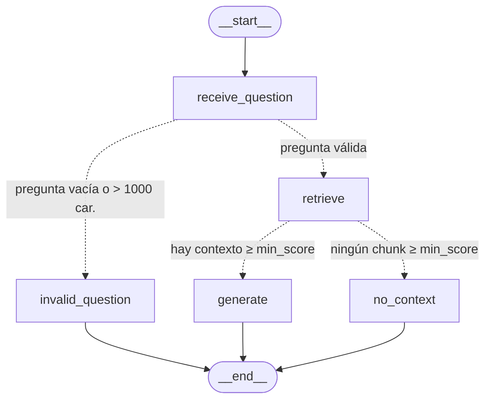

# Agente de conocimiento de TrackFlow con LangGraph (Parte 1)

**Para quién:** desarrolladores que mantengan el agente o le añadan capacidades en la Parte 2.
**Qué cambia respecto al RAG del Hito 7:** el comportamiento es el mismo: mismos `retrieve()` y `generate_answer()` de `mock_data/pipelines/rag.py` (el `data/pipelines/` del enunciado), misma colección `trackflow_knowledge` y mismo umbral. La diferencia es que el flujo ya no es una caja negra: es un grafo compilado con estado explícito, checkpoints y un trace consultable de cada corrida.

| Pieza | Dónde |
|---|---|
| Estado, nodos, aristas y compilación | `services/agent/graph.py` |
| Trace persistente | `services/agent/tracing.py` (SQLite) |
| Consultar traces | `uv run python -m services.agent.inspect [run_id]` |
| Endpoint | `POST /agent/query` en `services/api/routes/agent.py` (convive con `POST /knowledge/query`) |
| Tests deterministas del grafo | `tests/pipelines/test_agent_graph.py` |
| Evals sobre traces | `tests/pipelines/test_agent_evals.py`, con casos en `mock_data/eval/agent-eval-cases.json` y traces en `mock_data/eval/agent-traces/` |

## Grafo

Generado con `compile_agent_graph(build_agent_graph()).get_graph().draw_mermaid()`. Las líneas discontinuas son aristas condicionales.



| Nodo | Única responsabilidad | Escribe |
|---|---|---|
| `receive_question` | Normaliza espacios y marca si la pregunta está vacía (< 3 caracteres) o es demasiado larga (> 1000). No decide el destino | `question`, `error` |
| `retrieve` | Llama a `retrieve(question, k=RAG_TOP_K, min_score=RAG_MIN_SCORE)` (5 y 0.45) | `context` |
| `generate` | Llama a `generate_answer(question, context)` con el contexto **ya recuperado** | `answer` |
| `no_context` | Respuesta honesta ("No tengo información suficiente…") sin forzar la generación | `answer` |
| `invalid_question` | Mensaje claro que pide una pregunta sobre SLA, devoluciones, transportistas o almacenamiento | `answer` |

**Contrato de nodos.** El grafo no usa `query()`, la composición monolítica de recuperación y generación. Así la recuperación se ejecuta una sola vez y el paso de generación es visible y trazable. Un test (`test_graph_uses_rag_functions_not_monolithic_query`) lo verifica.

## Estado mínimo

```python
class AgentState(TypedDict):
    question: str                                   # pregunta normalizada
    context: NotRequired[list[RetrievedChunk]]      # salida de retrieve (payload del CONTEXT + score)
    answer: NotRequired[str]                        # respuesta final
    error: NotRequired[Literal["empty_question", "question_too_long"]]
```

**No incluye el historial de la conversación.** El asistente comercial responde preguntas independientes sobre los acuerdos estándar, y ningún nodo necesita turnos anteriores para decidir. Llevarlo solo aumentaría el tamaño de cada checkpoint. Si en la Parte 2 hace falta memoria conversacional, se añadirá como clave nueva, justificada y validada por `validate_structure`.

## Compilación: los errores estructurales fallan al construir, no en producción

`compile_agent_graph()` primero ejecuta `validate_structure()` y después `StateGraph.compile()`. La validación propia existe porque se comprobó que **LangGraph compila sin error**:

- un nodo huérfano;
- un nodo sin arista de salida;
- un nodo que escribe claves que no existen en el estado (al ejecutar, las ignora en silencio).

| Error estructural | Quién lo detecta |
|---|---|
| Nodo sin conexión desde `START` | `validate_structure` |
| Nodo sin arista de salida, o ningún camino a `END` | `validate_structure` |
| Nodo que declara escribir claves fuera de `AgentState` | `validate_structure` (con `NODE_WRITES`) |
| Nodo que en ejecución devuelve una clave no declarada | Envoltorio del nodo, que la convierte en error del nodo |
| Arista hacia un nodo inexistente, o grafo sin entrada | `StateGraph.compile()` |

Todos se reportan como `AgentGraphStructureError`. El router del API compila el grafo **al importarse**, así que un grafo mal construido impide que arranque el servidor.

## Checkpointing

`KnowledgeAgent` compila con un `SqliteSaver` (`<AGENT_DATA_DIR>/checkpoints.sqlite`) y ejecuta con `durability="sync"`. Así cada transición queda escrita antes de pasar al siguiente nodo. El `thread_id` de cada corrida es su `run_id`. Una corrida que va por el camino de generación deja 5 checkpoints: `__start__`, `receive_question`, `retrieve`, `generate` y el estado final. Se pueden inspeccionar con `KnowledgeAgent.checkpoints(run_id)` (`get_state_history`) desde otro proceso, porque el archivo es persistente.

## Tracing

Se usa un **log estructurado propio en SQLite** (`<AGENT_DATA_DIR>/traces.sqlite`) en lugar de LangSmith: no hay acceso a esa herramienta y así las preguntas y los chunks no salen a un servicio externo.

- **`agent_runs`:** `run_id`, `question`, estado (`running`, `completed` o `failed`), nodo final, tipo de error y marcas de tiempo.
- **`agent_trace_steps`:** cada nodo ejecutado y cada decisión de arista, en orden (`seq`), con duración, estado (`ok` o `error`) y salida. Por ejemplo, para `retrieve` se guardan los chunks con `source_document`, `section` y `score`. Para una arista se guardan el destino y el motivo.

El endpoint devuelve el `run_id` en la cabecera `X-Agent-Run-Id`. Con ese valor, `uv run python -m services.agent.inspect <run_id>` muestra el trace completo en JSON. Si un nodo falla, el trace registra el paso con `status=error` y el tipo de excepción, y la corrida queda en `failed` con el nodo que falló.

## Endpoint

`POST /agent/query` (autenticado) recibe `{"question": "..."}` y devuelve `{"answer": "..."}`. No tiene lógica de negocio propia: solo traduce a HTTP el resultado del grafo.

| Resultado del grafo | HTTP |
|---|---|
| `generate` o `no_context` | 200 `{answer}` |
| `invalid_question` | 422 con el mensaje del nodo |
| Falla un nodo por configuración o servicio no disponible (`RuntimeError`, p. ej. LLM sin configurar) | 503 "El agente de conocimiento no está disponible en este momento." |
| Falla un nodo por cualquier otro error (Qdrant caído…) | 502 "El agente no pudo completar la respuesta…" |

Nunca devuelve un stack trace, chunks ni puntuaciones. En compose, el backend monta `./services/agent` y guarda checkpoints y traces en el volumen `backend_data` (`AGENT_DATA_DIR=/var/lib/trackflow/agent`).

## Evals (contra traces, no en vivo)

```bash
uv run pytest tests/pipelines/test_agent_evals.py     # evals del agente (lee traces grabados)
uv run python scripts/record_agent_traces.py          # regraba los traces (necesita Qdrant y LLM)
```

`scripts/record_agent_traces.py` ejecuta el grafo **real** (Qdrant, embeddings y LLM) una vez por caso y exporta el trace completo. Los evals comprueban los criterios contra esos archivos.

| Caso | Pregunta | Criterios sobre el trace |
|---|---|---|
| `carrier-aragon-rural` | ¿Qué transportista cubre mejor Aragón rural? | orden `receive_question → retrieve → generate`; se recuperó `carrier-coverage#1`; **la respuesta menciona SEUR** |
| `returns-standard-window` | ¿Cuál es la ventana de devolución estándar? | se recuperó `returns-policy#1`; **la respuesta dice "30 días"** |
| `storage-discount-needs-approval` | Un cliente grande pide un descuento… | se recuperó `storage-pricing#4`; **la respuesta menciona a Miguel Torres** |
| `sla-black-friday-not-guaranteed` | ¿Podemos garantizar los plazos durante Black Friday? | se recuperó `sla-delivery#4`; **la respuesta dice que no se garantiza y menciona "40%"** |
| `out-of-domain-no-context` | ¿Qué receta lleva una paella valenciana? | 0 chunks; la ruta va a `no_context`; `generate` **no** se ejecuta; respuesta honesta |
| `empty-question-invalid` | (vacía) | `receive_question → invalid_question`; `retrieve` y `generate` no se ejecutan |

**El anclaje es criterio de aceptación**, no solo el enrutamiento. `test_perfect_trace_with_ungrounded_answer_fails_the_eval` demuestra que un trace con el recorrido perfecto pero una respuesta que ignora la política ("recomendamos MRW") **falla** el eval.

## LLM de generación usado para grabar los traces

El proyecto no usa los LLM de 4Geeks y la generación se configura por entorno (`LLM_API_URL`, `LLM_API_KEY`, `GENERATION_MODEL`). Los traces de `mock_data/eval/agent-traces/` se grabaron con un **LLM local de desarrollo**: Ollama 0.12.6 con `qwen2.5:1.5b` en `http://127.0.0.1:11434/v1`, en CPU. Cada traza registra en `recorded_with` qué modelos se usaron.

Limitaciones observadas con ese modelo pequeño:

- tarda entre 10 y 60 s por respuesta en CPU;
- **no añadió la línea `Fuente:`** de la regla 6 del prompt en ninguna de las 4 respuestas grabadas. La trazabilidad a la fuente queda cubierta por el trace, que registra los chunks recuperados (`source_document`, `section`), pero el texto de la respuesta no los cita;
- en el caso del descuento empieza con "No tengo información suficiente…" antes de remitir a Miguel Torres.

Los datos de negocio sí salen anclados. Con el LLM de producción elegido hay que regrabar los traces y volver a pasar los evals.
