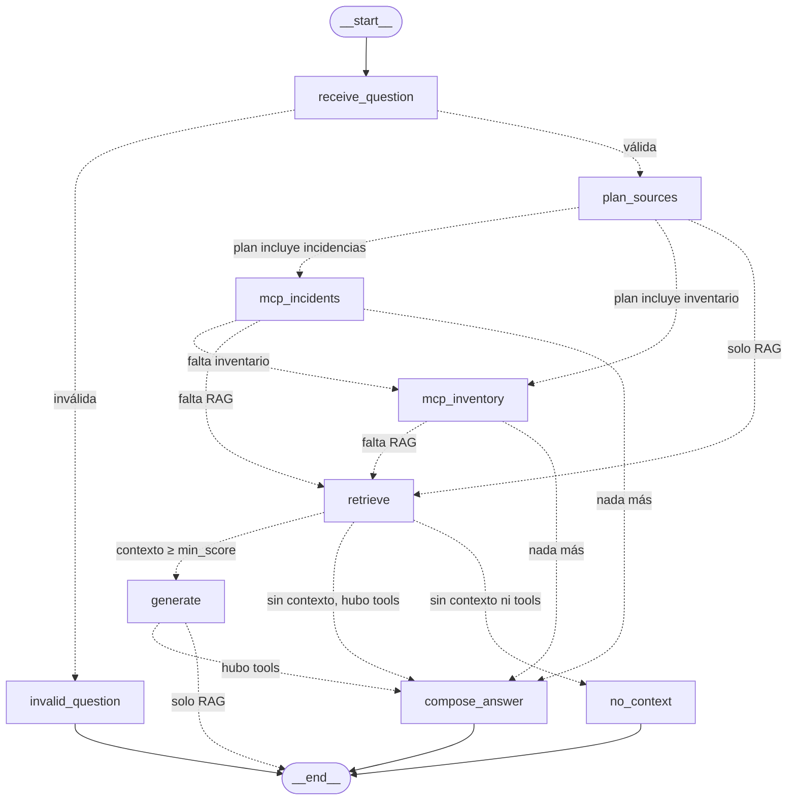

# Agente de soporte de TrackFlow con LangGraph (Partes 1 y 2, y migración a MCP)

**Para quién:** desarrolladores que mantengan el agente o le añadan capacidades en la Parte 2.
**Qué cambia respecto al RAG del Hito 7:** el comportamiento es el mismo: mismos `retrieve()` y `generate_answer()` de `mock_data/pipelines/rag.py` (el `data/pipelines/` del enunciado), misma colección `trackflow_knowledge` y mismo umbral. La diferencia es que el flujo ya no es una caja negra: es un grafo compilado con estado explícito, checkpoints y un trace consultable de cada corrida.

| Pieza | Dónde |
|---|---|
| Estado, nodos, aristas y compilación | `services/agent/graph.py` |
| Trace persistente | `services/agent/tracing.py` (SQLite) |
| Consultar traces | `uv run python -m services.agent.inspect [run_id]` |
| Endpoint | `POST /agent/query` en `services/api/routes/agent.py` (convive con `POST /knowledge/query`) |
| Tests deterministas del grafo | `tests/pipelines/test_agent_graph.py` |
| Evals sobre traces | `tests/pipelines/test_agent_evals.py`, con casos en `mock_data/eval/agent-eval-cases.json` y traces en `mock_data/eval/agent-traces/` |

## Grafo

Generado desde `compile_agent_graph(build_agent_graph()).get_graph()`. Las líneas discontinuas son aristas condicionales. La Parte 2 añade `plan_sources`, los nodos de tools y `compose_answer` (ver [Parte 2](#parte-2-tools-de-incidencias-e-inventario)). Desde la [migración a MCP](#migración-a-mcp-el-agente-como-cliente-del-servidor-mcp), los nodos de tools son **clientes del servidor MCP**: `mcp_incidents` y `mcp_inventory`.



| Nodo | Única responsabilidad | Escribe |
|---|---|---|
| `receive_question` | Normaliza espacios y marca si la pregunta está vacía (< 3 caracteres) o es demasiado larga (> 1000). No decide el destino | `question`, `error` |
| `retrieve` | Llama a `retrieve(question, k=RAG_TOP_K, min_score=RAG_MIN_SCORE)` (5 y 0.45) | `context` |
| `generate` | Llama a `generate_answer(question, context)` con el contexto **ya recuperado** | `answer` |
| `no_context` | Respuesta honesta ("No tengo información suficiente…") sin forzar la generación | `answer` |
| `invalid_question` | Mensaje claro que pide una pregunta sobre SLA, devoluciones, transportistas o almacenamiento | `answer` |

**Contrato de nodos.** El grafo no usa `query()`, la composición monolítica de recuperación y generación. Así la recuperación se ejecuta una sola vez y el paso de generación es visible y trazable. Un test (`test_graph_uses_rag_functions_not_monolithic_query`) lo verifica.

## Estado mínimo

```python
class AgentState(TypedDict):
    question: str                                   # pregunta normalizada
    context: NotRequired[list[RetrievedChunk]]      # salida de retrieve (payload del CONTEXT + score)
    answer: NotRequired[str]                        # respuesta final
    error: NotRequired[Literal["empty_question", "question_too_long"]]
```

**No incluye el historial de la conversación.** El asistente comercial responde preguntas independientes sobre los acuerdos estándar, y ningún nodo necesita turnos anteriores para decidir. Llevarlo solo aumentaría el tamaño de cada checkpoint. Si en la Parte 2 hace falta memoria conversacional, se añadirá como clave nueva, justificada y validada por `validate_structure`.

## Compilación: los errores estructurales fallan al construir, no en producción

`compile_agent_graph()` primero ejecuta `validate_structure()` y después `StateGraph.compile()`. La validación propia existe porque se comprobó que **LangGraph compila sin error**:

- un nodo huérfano;
- un nodo sin arista de salida;
- un nodo que escribe claves que no existen en el estado (al ejecutar, las ignora en silencio).

| Error estructural | Quién lo detecta |
|---|---|
| Nodo sin conexión desde `START` | `validate_structure` |
| Nodo sin arista de salida, o ningún camino a `END` | `validate_structure` |
| Nodo que declara escribir claves fuera de `AgentState` | `validate_structure` (con `NODE_WRITES`) |
| Nodo que en ejecución devuelve una clave no declarada | Envoltorio del nodo, que la convierte en error del nodo |
| Arista hacia un nodo inexistente, o grafo sin entrada | `StateGraph.compile()` |

Todos se reportan como `AgentGraphStructureError`. El router del API compila el grafo **al importarse**, así que un grafo mal construido impide que arranque el servidor.

## Checkpointing

`KnowledgeAgent` compila con un `SqliteSaver` (`<AGENT_DATA_DIR>/checkpoints.sqlite`) y ejecuta con `durability="sync"`. Así cada transición queda escrita antes de pasar al siguiente nodo. El `thread_id` de cada corrida es su `run_id`. Una corrida que va por el camino de generación deja 5 checkpoints: `__start__`, `receive_question`, `retrieve`, `generate` y el estado final. Se pueden inspeccionar con `KnowledgeAgent.checkpoints(run_id)` (`get_state_history`) desde otro proceso, porque el archivo es persistente.

## Tracing

Se usa un **log estructurado propio en SQLite** (`<AGENT_DATA_DIR>/traces.sqlite`) en lugar de LangSmith: no hay acceso a esa herramienta y así las preguntas y los chunks no salen a un servicio externo.

- **`agent_runs`:** `run_id`, `question`, estado (`running`, `completed` o `failed`), nodo final, tipo de error y marcas de tiempo.
- **`agent_trace_steps`:** cada nodo ejecutado y cada decisión de arista, en orden (`seq`), con duración, estado (`ok` o `error`) y salida. Por ejemplo, para `retrieve` se guardan los chunks con `source_document`, `section` y `score`. Para una arista se guardan el destino y el motivo.

El endpoint devuelve el `run_id` en la cabecera `X-Agent-Run-Id`. Con ese valor, `uv run python -m services.agent.inspect <run_id>` muestra el trace completo en JSON. Si un nodo falla, el trace registra el paso con `status=error` y el tipo de excepción, y la corrida queda en `failed` con el nodo que falló.

## Endpoint

`POST /agent/query` (autenticado) recibe `{"question": "..."}` y devuelve `{"answer": "..."}`. No tiene lógica de negocio propia: solo traduce a HTTP el resultado del grafo.

| Resultado del grafo | HTTP |
|---|---|
| `generate` o `no_context` | 200 `{answer}` |
| `invalid_question` | 422 con el mensaje del nodo |
| Falla un nodo por configuración o servicio no disponible (`RuntimeError`, p. ej. LLM sin configurar) | 503 "El agente de conocimiento no está disponible en este momento." |
| Falla un nodo por cualquier otro error (Qdrant caído…) | 502 "El agente no pudo completar la respuesta…" |

Nunca devuelve un stack trace, chunks ni puntuaciones. En compose, el backend monta `./services/agent` y guarda checkpoints y traces en el volumen `backend_data` (`AGENT_DATA_DIR=/var/lib/trackflow/agent`).

## Evals (contra traces, no en vivo)

```bash
uv run pytest tests/pipelines/test_agent_evals.py     # evals del agente (lee traces grabados)
uv run python scripts/record_agent_traces.py          # regraba los traces (necesita Qdrant y LLM)
```

`scripts/record_agent_traces.py` ejecuta el grafo **real** (Qdrant, embeddings y LLM) una vez por caso y exporta el trace completo. Los evals comprueban los criterios contra esos archivos.

| Caso | Pregunta | Criterios sobre el trace |
|---|---|---|
| `carrier-aragon-rural` | ¿Qué transportista cubre mejor Aragón rural? | orden `receive_question → retrieve → generate`; se recuperó `carrier-coverage#1`; **la respuesta menciona SEUR** |
| `returns-standard-window` | ¿Cuál es la ventana de devolución estándar? | se recuperó `returns-policy#1`; **la respuesta dice "30 días"** |
| `storage-discount-needs-approval` | Un cliente grande pide un descuento… | se recuperó `storage-pricing#4`; **la respuesta menciona a Miguel Torres** |
| `sla-black-friday-not-guaranteed` | ¿Podemos garantizar los plazos durante Black Friday? | se recuperó `sla-delivery#4`; **la respuesta dice que no se garantiza y menciona "40%"** |
| `out-of-domain-no-context` | ¿Qué receta lleva una paella valenciana? | 0 chunks; la ruta va a `no_context`; `generate` **no** se ejecuta; respuesta honesta |
| `empty-question-invalid` | (vacía) | `receive_question → invalid_question`; `retrieve` y `generate` no se ejecutan |

**El anclaje es criterio de aceptación**, no solo el enrutamiento. `test_perfect_trace_with_ungrounded_answer_fails_the_eval` demuestra que un trace con el recorrido perfecto pero una respuesta que ignora la política ("recomendamos MRW") **falla** el eval.

## LLM de generación usado para grabar los traces

El proyecto no usa los LLM de 4Geeks y la generación se configura por entorno (`LLM_API_URL`, `LLM_API_KEY`, `GENERATION_MODEL`). Los traces de `mock_data/eval/agent-traces/` se grabaron con un **LLM local de desarrollo**: Ollama 0.12.6 con `qwen2.5:1.5b` en `http://127.0.0.1:11434/v1`, en CPU. Cada traza registra en `recorded_with` qué modelos se usaron.

Limitaciones observadas con ese modelo pequeño:

- tarda entre 10 y 60 s por respuesta en CPU;
- **no añadió la línea `Fuente:`** de la regla 6 del prompt en ninguna de las 4 respuestas grabadas. La trazabilidad a la fuente queda cubierta por el trace, que registra los chunks recuperados (`source_document`, `section`), pero el texto de la respuesta no los cita;
- en el caso del descuento empieza con "No tengo información suficiente…" antes de remitir a Miguel Torres.

Los datos de negocio sí salen anclados. Con el LLM de producción elegido hay que regrabar los traces y volver a pasar los evals.


## Parte 2: tools de incidencias e inventario

Los datos operativos (estado de un ticket, stock de un producto) **no** se indexan en el RAG, porque cambian en tiempo real. El agente los consulta en vivo con dos tools de **solo lectura**, cada una con una sola responsabilidad (`services/agent/tools.py`).

> **Actualizado con la migración a MCP.** El transporte y la autenticación que se describen debajo (HTTP directo a `services/api` con el JWT del usuario o `AGENT_API_TOKEN`) eran los de la Parte 2 y **ya no existen**. Hoy `lookup_incidents` y `lookup_inventory` invocan las tools del servidor MCP desde los nodos `mcp_incidents` y `mcp_inventory`. Ver [Migración a MCP](#migración-a-mcp-el-agente-como-cliente-del-servidor-mcp). Contratos, enrutamiento, fallback y redacción siguen igual; el timeout pasa a 8 s por llamada MCP.

| Tool | Servicio real | Entrada tipada | Salida tipada |
|---|---|---|---|
| `lookup_incidents` | Gestor de incidencias: `GET /api/incidents/{id}` o `GET /api/incidents?status=&category=&origin=&branch=` | `IncidentQuery`: `ticket_id` (UUID) o filtros `status`, `category`, `origin`, `branch` | `IncidentToolResult`: `ok`, `mode` (`detail`/`list`), `incidents[]` (`id`, `title`, `status`, `category`, `origin`, `branch`, `created_at`, `updated_at`), `total`, `error_type` |
| `lookup_inventory` | Gestor de inventario: `GET /inventory/products` | `InventoryQuery`: `sku` exacto o `name_terms`, y `warehouse` opcional (`LA`/`ZGZ`) | `InventoryToolResult`: `ok`, `items[]` (`sku`, `name`, `client_name`, `warehouse`, `current_stock`, `minimum_stock`), `error_type` |

**Transporte.** Las tools llaman por HTTP al API real (`AGENT_API_BASE_URL`, por defecto `http://127.0.0.1:8081`, el mismo proceso FastAPI en compose). No se usan datos simulados ni un dataset paralelo. Llamar por HTTP reutiliza la validación, la caché y la autenticación de cada router sin duplicar su lógica.

**Autenticación.** Los dos routers exigen un JWT de usuario. El orden de preferencia es:

1. El JWT de quien llama a `POST /agent/query`, que el endpoint reenvía. El agente consulta con los permisos del propio account manager.
2. `AGENT_API_TOKEN` del entorno, para scripts y para grabar los evals. Es una cuenta de servicio creada con el propio `POST /users`.

No hay ningún token hardcodeado. El token se entrega por corrida **fuera del estado**: no queda en checkpoints ni en traces, y hay un test que lo verifica.

**Solo lectura.** El cliente HTTP tiene un hook que bloquea cualquier método distinto de `GET` *antes* de enviarlo (`ReadOnlyViolation`). Ninguna tool puede crear, actualizar ni borrar tickets.

**Timeout explícito: `TOOL_TIMEOUT_SECONDS = 4.0`.** `GET /inventory/products` tarda entre 0,6 y 1,2 s medido contra Supabase. Un test levanta un servidor HTTP local que tarda 1,5 s en responder y comprueba que la tool corta en el timeout configurado sin colgarse.

**Fallback honesto.** Cuando una tool falla, el grafo no se rompe: la tool devuelve `error_type` y `compose_answer` responde sin inventar estados ni cantidades.

| `error_type` | Respuesta |
|---|---|
| `timeout` / `unavailable` / `bad_response` | "No pude confirmar el estado de ese ticket ahora mismo: el gestor de incidencias no respondió a tiempo / no está disponible. No te doy ningún estado para no inventarlo…" |
| `not_found` | "No encontré ningún ticket con el identificador … en el gestor de incidencias." |
| `invalid_query` (p. ej. "ticket 482") | "No pude buscar el ticket «482»: en TrackFlow los tickets se identifican con un UUID… Compártelo completo y lo consulto." |
| `unauthorized` | "No pude consultar el gestor de incidencias porque la consulta no tiene credenciales válidas." |

Una excepción inesperada dentro de la tool también se convierte en `unavailable`.

**Redacción determinista.** El estado del ticket y el stock se escriben tal cual los devolvió el servicio (`services/agent/answers.py`), sin pasar por el LLM, para que el modelo no pueda alterar un dato operativo. El LLM solo redacta la parte del RAG.

### Enrutamiento automático (`services/agent/routing.py`)

`plan_sources` decide a partir de la pregunta, sin que el usuario indique la fuente. Es un clasificador **determinista por reglas**: cada decisión queda en el trace con su motivo y no depende de la calidad de *tool calling* del LLM de desarrollo.

| Señal en la pregunta | Fuente |
|---|---|
| UUID de ticket, o las palabras ticket, incidencia o incidente (se extraen estado, categoría, origen y sede como filtros) | `incidents` |
| Código SKU, o "stock / existencias / unidades **de** …", "¿hay / tenemos / quedan stock…?" | `inventory` |
| Ninguna tool | `rag` |
| Tool + términos de política (ventana, SLA, tarifa, descuento, cobertura, Black Friday…) | tool(s) y después `rag` |

- **Orden de ejecución:** incidencias → inventario → RAG.
- **Preguntas de política no se desvían:** las 23 preguntas de `test-queries.json` siguen yendo solo al RAG, y hay un test que lo comprueba. Por ejemplo, "¿qué se cobra por el **stock** que lleva seis meses sin venderse?" es política de inventario de larga duración, no una consulta de stock.
- **Preguntas mixtas:** el RAG busca solo con la parte de política (`plan.rag_question`). Con el UUID del ticket dentro de la consulta, el mejor chunk puntuaba 0,419, por debajo de `min_score` (0,45); con la sub-pregunta, 0,57. El texto se conserva con mayúsculas y tildes porque el modelo de embeddings es sensible a ellas: normalizado puntuaba 0,426.

### Trace

Cada corrida guarda `sources_used`, las fuentes en orden (`["incidents", "rag"]`), en `agent_runs`, y los nodos de tools (`mcp_incidents`, `mcp_inventory`) con su resultado tipado en `agent_trace_steps`, que incluye la tool MCP invocada (`mcp_tool`). `python -m services.agent.inspect` lista las corridas con sus fuentes.

### Evals nuevos (contra traces grabados con los servicios reales)

| Caso | Verifica |
|---|---|
| `tool-ticket-status-by-id` | Ticket real `d32a9b66-…` → solo `incidents`; `retrieve` y `generate` no se ejecutan; la respuesta refleja el estado que devolvió el servicio (Abierta) |
| `tool-ticket-search-open-returns` | "¿Cuántas incidencias de devolución están abiertas?" → filtros `status=open` y `category=returns_issue`; la respuesta da el total real (6) |
| `tool-inventory-stock-by-sku` | TEC-EAR-001 → solo `inventory`; la respuesta da el stock real (74) |
| `returns-standard-window` y el resto de casos de la Parte 1 | Solo `rag`; ninguna tool se ejecuta |
| `mixed-ticket-and-policy` | `incidents` → `rag`, en ese orden; estado real del ticket y "30 días" |
| `fallback-incidents-service-down` | Grabado con el servidor MCP realmente caído (puerto cerrado) → `error_type=unavailable`, respuesta honesta, **sin ningún estado** |
| `fallback-ticket-reference-not-uuid` | "ticket 482" → `invalid_query`, sin estado inventado |

## Migración a MCP: el agente como cliente del servidor MCP

El servidor MCP de TrackFlow (`mcps/trackflow_mcp`, documentado en su [README](../../mcps/trackflow_mcp/README.md)) expone el Incidents Manager y el inventario a cualquier cliente MCP autorizado con OAuth 2.1. El agente es ahora uno de esos clientes.

| Antes (Parte 2) | Ahora |
|---|---|
| Nodos `lookup_incidents` / `lookup_inventory` → `httpx` → `GET /api/incidents…`, `GET /inventory/products` | Nodos `mcp_incidents` / `mcp_inventory` → `langchain-mcp-adapters` (`MultiServerMCPClient`, Streamable HTTP) → tools MCP `incidents_get_ticket`, `incidents_list_tickets`, `inventory_query_products` → servidor MCP → `services/api` |
| JWT del usuario reenviado, o `AGENT_API_TOKEN` | OAuth 2.1 `client_credentials` como `trackflow-agent` (`AGENT_OAUTH_CLIENT_ID` / `AGENT_OAUTH_CLIENT_SECRET`, `OIDC_ISSUER`). Scopes: `mcp:access incidents:read inventory:read`. El JWT del usuario solo autoriza `POST /agent/query` y ya no se reenvía |
| Hook GET-only en el cliente HTTP | Lista blanca de tools de lectura en el cliente MCP (`ReadOnlyViolation`) **y** un token sin `incidents:write`. Si el agente intentara escribir, el servidor respondería `INSUFFICIENT_SCOPE` |
| `TOOL_TIMEOUT_SECONDS = 4.0` por petición HTTP | `TOOL_TIMEOUT_SECONDS = 8.0` por llamada MCP, que incluye discovery, sesión e invocación: medido de 30 a 220 ms por llamada y unos 870 ms para el inventario contra Supabase |

**Un solo camino hacia el Incidents Manager.** La implementación HTTP directa se **eliminó** de `services/agent/tools.py`; queda solo en el historial de git, en el PR #38. Desaparecen `AGENT_API_BASE_URL` y `AGENT_API_TOKEN`. Un test (`test_agent_has_a_single_path_to_the_incidents_manager`) falla si algún módulo del agente vuelve a llamar a `/api/incidents` o `/inventory` por HTTP.

**Enrutamiento idéntico.** `plan_sources`, las aristas condicionales, el orden incidencias → inventario → RAG, `rag_question` y `compose_answer` no cambian. Solo cambia el nodo que ejecuta cada tool. Lo comprueban:
- los tests de enrutamiento existentes;
- `tests/mcp_server/test_agent_via_mcp.py`, con la pila completa: agente → adapters → servidor MCP con OAuth → backend;
- los evals, regrabados con los servicios reales a través del servidor MCP. Exigen además la tool MCP usada (`mcp_tool`).

**Errores del servidor MCP → fallback del agente.**

| Código del servidor MCP / transporte | `error_type` del agente |
|---|---|
| `NOT_FOUND` | `not_found` |
| `VALIDATION_ERROR` | `invalid_query` |
| `INSUFFICIENT_SCOPE`, HTTP 401/403 de MCP Auth | `unauthorized` |
| `BACKEND_TIMEOUT`, timeout del cliente MCP | `timeout` |
| `BACKEND_UNAVAILABLE`, `BACKEND_AUTH_FAILED`, servidor MCP caído | `unavailable` |

### Cómo levantarlo en local

```bash
# 1. Incidencias reales del proyecto en una TinyDB de desarrollo (seed oficial del CSV de incidencias)
cd services/api && uv run python ../../scripts/seed_incidents.py --db /ruta/incidents-dev.json
# 2. API real sobre esa TinyDB (el inventario sale de Postgres/Supabase con DATABASE_URL)
SUPPLIERS_DB_PATH=/ruta/incidents-dev.json SECRET_KEY=... uv run uvicorn main:app --port 8081
# 3. Proveedor OIDC + servidor MCP (ver mcps/trackflow_mcp/README.md)
# 4. Regrabar traces (el agente va por el servidor MCP) y pasar los evals
OIDC_ISSUER=... MCP_SERVER_URL=http://127.0.0.1:8090/mcp AGENT_OAUTH_CLIENT_ID=trackflow-agent AGENT_OAUTH_CLIENT_SECRET=... \
  LLM_API_URL=... GENERATION_MODEL=... uv run python scripts/record_agent_traces.py
uv run pytest tests/pipelines/test_agent_evals.py
```
