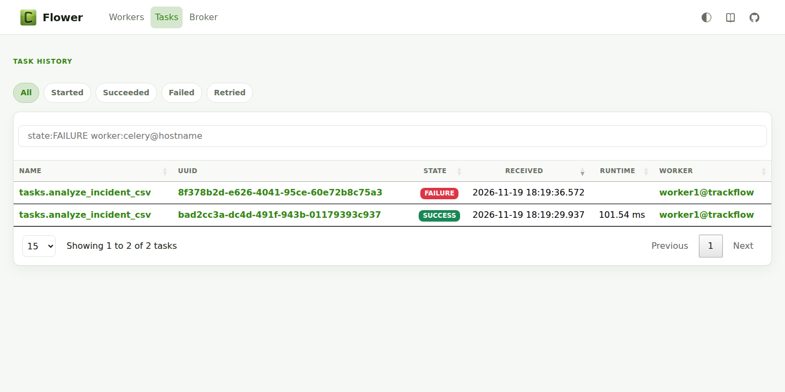

# Demostración real de las tareas asíncronas (revisión del PR #31)

Esta evidencia se generó el 2026-11-19 en un codespace de 2 vCPU. Los archivos no contienen credenciales; se comprobó con la URL de la base de datos y los tokens efímeros.

## Cómo se levantó

El `docker-compose.yml` exige un `.env`, que es ruta protegida y no existe en este checkout. Por eso se levantaron los mismos servicios por separado:

| Servicio | Cómo |
|---|---|
| Redis (broker y backend) | `docker run redis:7-alpine redis-server --appendonly yes --maxmemory-policy noeviction`, con los mismos flags que el compose |
| Worker | `celery -A celery_app:app worker --concurrency=2 -n worker1@trackflow -E`, un proceso aparte de FastAPI |
| Flower | `celery -A celery_app:app flower --port=5555 --basic-auth=…` |
| API | `uvicorn main:app`, desde `services/api`, con el código de esta rama |
| DLQ | `public.task_dead_letters` en Supabase (`DATABASE_URL`) |

`SECRET_KEY`, `TASKS_INTERNAL_TOKEN` y `FLOWER_BASIC_AUTH` fueron valores efímeros generados solo para la demo; no se escribieron en el repositorio. Las tareas se enviaron a `POST /internal/tasks/analyze`, el adaptador que usa el gateway. Comparte `_enqueue_uploaded_file` con `/api/incidents/analyze`, así que la validación, la persistencia y el encolado son los mismos.

## 1. Migración de la DLQ aplicada

[01-dlq-migration.txt](01-dlq-migration.txt): antes, `to_regclass('public.task_dead_letters')` era `NULL`. Se aplicó `20261118120000_create_task_dead_letters.sql` y ahora existe con sus 5 columnas.

## 2. Una tarea completada y una fallida

[02-enqueue-202.txt](02-enqueue-202.txt): las dos peticiones devuelven `202` con su `task_id` de inmediato.

| Tarea | Entrada | Resultado |
|---|---|---|
| `bad2cc3a…` | `scripts/incidents-trackflow.csv` (válido) | **SUCCESS** en 0,10 s: 100 registros, 95 válidos |
| `8f378b2d…` | CSV con cabecera inválida | **FAILURE** tras 4 intentos: `CSVFormatError` |

Capturas reales de Flower:

- [05-flower-tasks.png](05-flower-tasks.png): historial con una tarea **SUCCESS** y otra **FAILURE** en `worker1@trackflow`.
- [06-flower-task-success.png](06-flower-task-success.png): detalle de la tarea completada.
- [07-flower-task-failure.png](07-flower-task-failure.png): detalle de la fallida, con **Retries: 3**, la excepción y el traceback.
- [08-flower-workers.png](08-flower-workers.png): worker en línea.

## 3. Reintentos con backoff, sin esperas de 0 s

[03-worker-retries-backoff.log](03-worker-retries-backoff.log) es el log real del worker:

| Intento | Hora | Espera programada | Mínimo garantizado |
|---|---|---|---|
| 1/4 → retry | 18:19:30.051 | **2,41 s** | 2 s |
| 2/4 → retry | 18:19:32.466 | **4,10 s** | 4 s |
| 3/4 → retry | 18:19:36.567 | **9,62 s** | 8 s |
| 4/4 → exhausted | 18:19:46.190 | DLQ | — |

Las esperas reales entre intentos coinciden con las programadas: 2,42 s, 4,10 s y 9,62 s.

**Corrección del jitter.** Con `retry_jitter=True`, Celery calcula `randrange(countdown + 1)`, que puede devolver 0 s en el primer reintento. Ahora `retry_countdown()` (`services/api/tasks.py`) usa `base = 2·2ⁿ`, con tope de 600 s, más un jitter positivo de como máximo un 25 %. El retardo nunca baja de 2, 4 u 8 s. Los tests `test_retry_countdown_has_floor_and_bounded_jitter` y `test_failure_schedules_retry_with_floor_countdown` lo verifican; el primero comprueba el mínimo con 1000 muestras.

## 4. Estado y fila en la DLQ

[04-task-states-and-dlq.txt](04-task-states-and-dlq.txt):

- Backend de resultados, con la misma lógica que `GET /tasks/{task_id}`: `success` (total_records=100) y `failure` (`CSVFormatError`).
- Fila real en `public.task_dead_letters`: `task_id=8f378b2d…`, `task_name=tasks.analyze_incident_csv`, **`attempts=4`**, `failed_at` y traceback completo.
- Los inputs de las dos tareas se borraron del volumen al terminar.

`GET /tasks/{id}` requiere un usuario autenticado y no se crearon cuentas para la demo. Su mapeo de estados está cubierto por `test_task_status_reports_lifecycle_states`.

## 5. Latencia del 202 por debajo de 200 ms

[09-latency-202.txt](09-latency-202.txt): 30 peticiones por tamaño, midiendo el tiempo hasta recibir el 202 completo.

**Dónde se iba el tiempo** con 10 MB, medido por componentes:

| Componente | Tiempo |
|---|---|
| `fsync` | **p50 188 ms, máx. 602 ms** |
| Escribir sin `fsync` | 14 ms |
| Parseo multipart | 9 ms |
| Decodificar UTF-8 | 4,5 ms |

Además, la escritura y `apply_async` se ejecutaban de forma bloqueante dentro de un handler `async`, frenando el event loop.

**Cambios:**

- Sin `fsync` por defecto. La escritura sigue siendo atómica (temporal + `rename`), así que el worker nunca lee un archivo a medias. `TASK_INPUT_FSYNC=1` lo reactiva para quien priorice la durabilidad.
- La E/S de disco y de Redis se ejecuta en el threadpool.

**Resultados con 10 MB (el límite):**

| Escenario | p50 | p95 | < 200 ms |
|---|---|---|---|
| Antes, worker procesando a la vez, sin calentamiento | 226 ms | 364 ms | 3/30 |
| `fsync=1`, worker en pausa | 155 ms | 190 ms | 30/30 (sin margen) |
| Después, worker procesando a la vez en el mismo host | 67 ms | 147 ms | **30/30** |
| Después, worker en pausa (equivale a un worker en otro host) | 71 ms | 108 ms | **30/30** |

Con 1 MB, el p95 baja de 198 ms a 9–23 ms.

**Límites honestos:**

- La primera tanda tras reiniciar el API, con 120 tareas de 10 MB en cola saturando las 2 vCPU, dio 28/30 por debajo de 200 ms con 10 MB (p95 219 ms). Con la CPU saturada no hay garantía absoluta para el tamaño máximo.
- Los archivos de hasta 5 MB quedan por debajo de 100 ms en todos los escenarios medidos después del cambio.
- No se midió el salto adicional del gateway Node.
- Sin `fsync`, un corte de energía o una caída del kernel antes del writeback puede perder el input. En ese caso la tarea termina en la DLQ, no se pierde en silencio.
