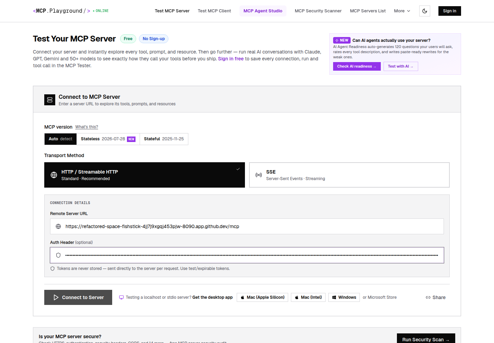
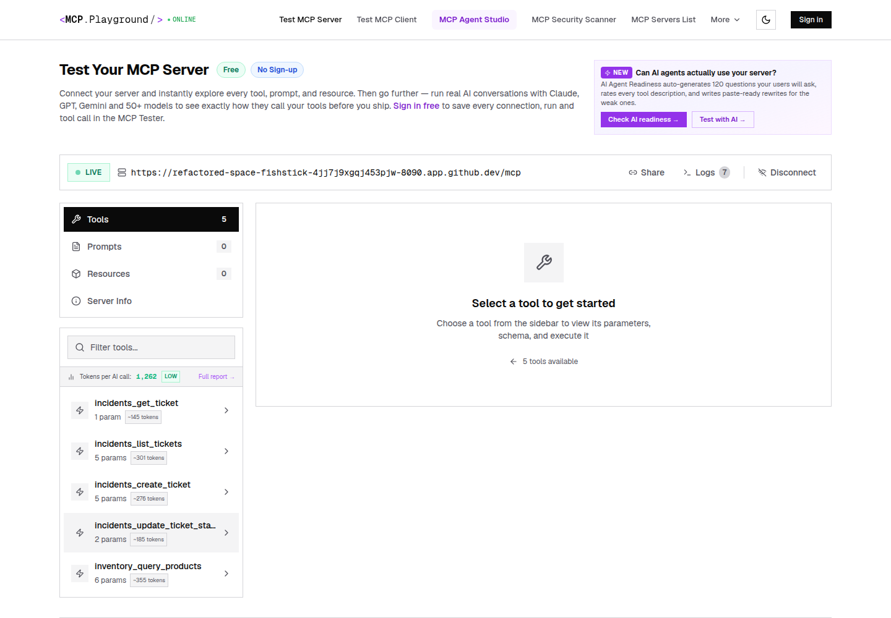
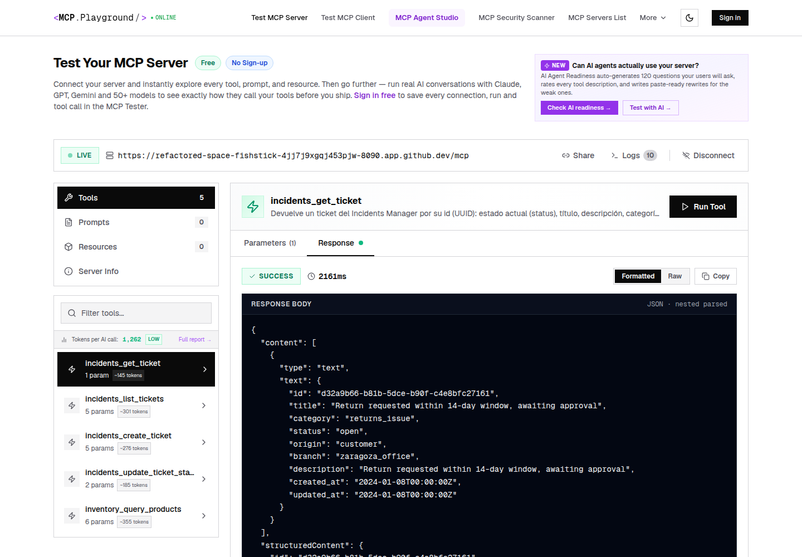
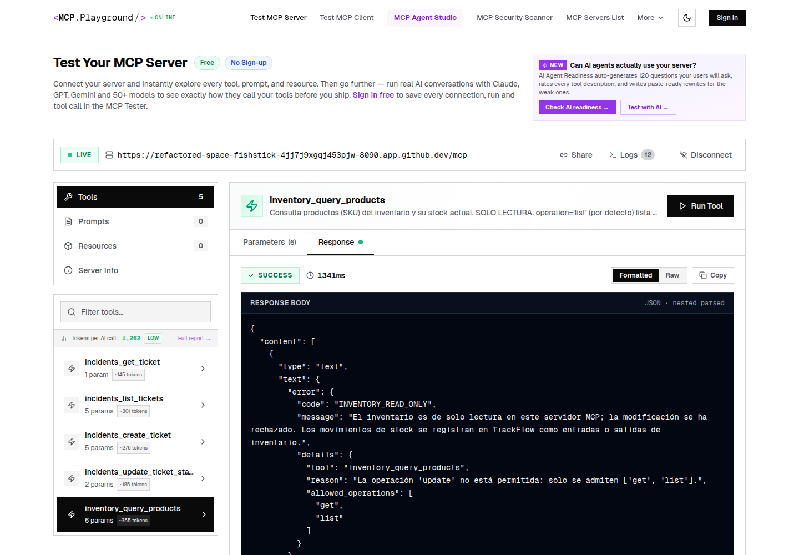
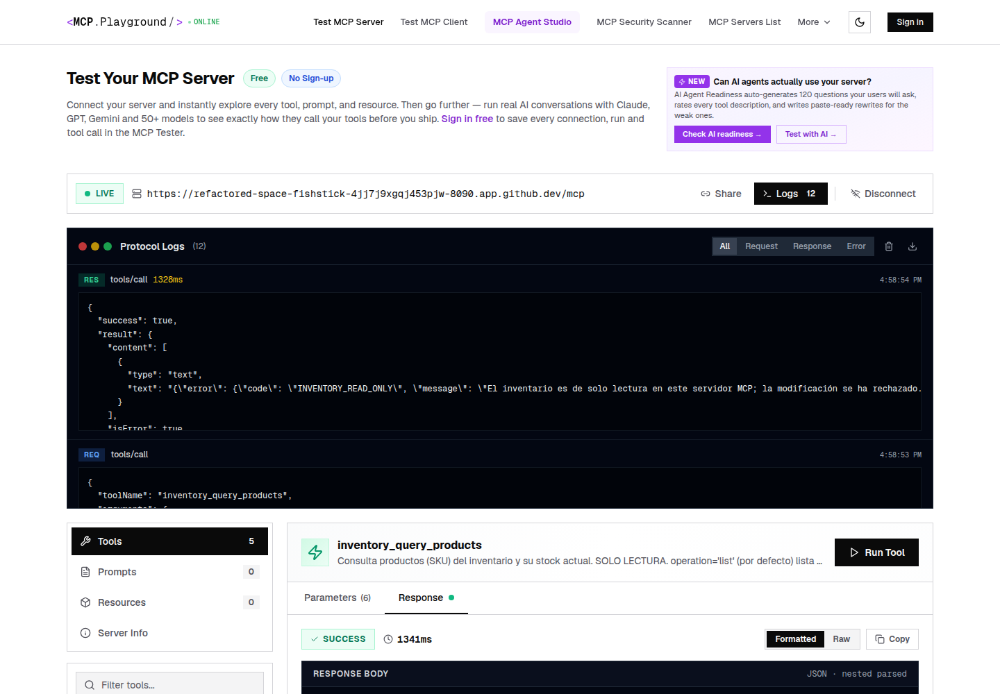

# Evidencias del servidor MCP de TrackFlow

Ejecución real del 2026-11-20 en GitHub Codespaces, con todo esto en marcha:
- el servidor MCP (`uv run python -m mcps.trackflow_mcp.server`), expuesto en el puerto reenviado **público** `https://<codespace>-8090.app.github.dev/mcp`;
- Keycloak 26 como proveedor OIDC;
- el API real de TrackFlow: el Incidents Manager, con 95 tickets del seed oficial, y el inventario en Postgres/Supabase.

Ningún archivo contiene tokens ni secretos (revisado con `grep`).

| Archivo | Qué es |
|---|---|
| [`checklist-public-url.txt`](checklist-public-url.txt) | Salida de `mcps/trackflow_mcp/dev/verify_checklist.py` **contra la URL pública de Codespaces**: PRM, discovery, 401 sin token, flujo completo de cada tool, intentos de escritura en inventario y códigos de error |
| [`checklist-localhost.txt`](checklist-localhost.txt) | La misma verificación contra `127.0.0.1:8090` |
| [`backend-access-log.txt`](backend-access-log.txt) | Log de acceso del API durante la verificación pública. Incidencias: `POST /api/incidents` y `PATCH /api/incidents/{id}/status`, nunca un PATCH genérico. Inventario: **solo GET**, también durante los intentos de escritura |
| [`audit-log-public-url.jsonl`](audit-log-public-url.jsonl) | Log de auditoría del servidor MCP: una línea por invocación con tool, cliente, scopes, resultado, código de error y duración, más los rechazos 401 |
| [`agent-via-public-mcp.json`](agent-via-public-mcp.json) | El agente LangGraph contra la URL pública: `plan_sources` → `mcp_incidents` (tool MCP `incidents_get_ticket`) → `compose_answer` |

## Checklist

| Criterio | Resultado | Evidencia |
|---|---|---|
| El servidor vive en `mcps/`, arranca y expone sus tools con el discovery estándar | ✅ | `mcps/trackflow_mcp/`. `initialize` devuelve `serverInfo` e instrucciones; `tools/list` devuelve 5 tools |
| Sin access token válido no se puede listar ni ejecutar ninguna tool | ✅ | `tools/list` y `tools/call` sin token → **401 `missing_auth_header`**; con token basura o firma alterada → **401 `invalid_token`**. `WWW-Authenticate` apunta a la PRM. Lo aplica MCP Auth (`mcpauth`) antes de llegar a MCP |
| Tickets: crear, cambiar el estado con `PATCH /api/incidents/{id}/status` y consultar contra el Incidents Manager real | ✅ | Ticket `c5f670bf-…` creado (`open`), pasado a `in_progress` y consultado. El log del API muestra `POST /api/incidents` 201, `PATCH …/status` 200 y, para la transición inválida, `PATCH …/status` 400 → `INVALID_STATUS_TRANSITION` |
| Inventario: responde a las consultas y rechaza explícitamente cualquier escritura | ✅ | `list` (ZGZ, 4 productos) y `get` (id 1, 58 uds.). `operation=update` con `current_stock` 999, `minimum_stock` y la tool inexistente `inventory_update_stock` → **`INVENTORY_READ_ONLY`** con `reason` y `allowed_operations`, **incluso con el token que tiene todos los scopes**. El stock sigue en 58 y el backend solo recibió GET |
| Descripción y esquema claros, verificables desde el discovery | ✅ | Sección 1/5 de `checklist-public-url.txt`: nombre, título, descripción con el scope requerido, `inputSchema` con enums y descripciones, `outputSchema` y anotaciones (`readOnlyHint`, `idempotentHint`). Las instrucciones del servidor listan scopes, transiciones y códigos de error |
| Los errores de autenticación, autorización y validación tienen códigos y mensajes distintos | ✅ | Autenticación: HTTP 401 `missing_auth_header` / `invalid_token` / `invalid_audience` / `invalid_issuer`. Base scope: HTTP 403 `missing_required_scopes`. Autorización por tool: `INSUFFICIENT_SCOPE` (con `required_scope` y `granted_scopes`). Validación: `VALIDATION_ERROR` (con `field`). Además: `INVALID_STATUS_TRANSITION`, `NOT_FOUND` e `INVENTORY_READ_ONLY` |
| Al menos un log por invocación de tool con cliente, tool y resultado | ✅ | `audit-log-public-url.jsonl`: 16 `tool_call` y 4 `auth_rejected` en la verificación pública |
| El agente ya no llama directamente al Incidents Manager | ✅ | Nodos `mcp_incidents` / `mcp_inventory` con `langchain-mcp-adapters` y OAuth `client_credentials` (`trackflow-agent`). La implementación HTTP directa se eliminó. Los evals se regrabaron con los servicios reales **a través del servidor MCP**: 17 passed, con el criterio `mcp_tool` |
| MCP Playground con la URL pública reenviada de Codespaces | ✅ | Sesión real en **mcpplaygroundonline.com** el 2026-11-21, conectada a `https://<codespace>-8090.app.github.dev/mcp` (no localhost) con un bearer token: 5 tools descubiertas, `incidents_get_ticket` ejecutada (ticket `d32a9b66-…`, `open`) e intento de escritura en inventario rechazado con `INVENTORY_READ_ONLY`. Capturas y trace del servidor en [`playground/`](#sesión-en-mcp-playground-2026-11-21) |

## Sesión en MCP Playground (2026-11-21)

Sesión real en la web de **MCP Playground** (`https://mcpplaygroundonline.com/mcp-test-server`), conectada a la URL **pública** reenviada por Codespaces, no a localhost.

Cómo se hizo: el navegador fue Chromium headless manejado con Playwright, con el script [`mcps/trackflow_mcp/dev/playground_session.cjs`](../../../mcps/trackflow_mcp/dev/playground_session.cjs), que la hace reproducible. La configuración fue:
- MCP version: Auto detect;
- transporte: HTTP / Streamable HTTP;
- Auth Header: `Bearer <token>` del cliente `trackflow-ops-console`, de 15 min.

El token solo se escribió en el campo enmascarado del Playground. El script comprobó que no aparece en el texto visible de ninguna pantalla, y tampoco está en los logs del servidor.

| Paso | Captura |
|---|---|
| 1. Formulario con la URL pública y el token enmascarado |  |
| 2. Conectado («LIVE»): 5 tools descubiertas por `tools/list` |  |
| 3. `incidents_get_ticket` con `d32a9b66-b81b-5dce-b90f-c4e8bfc27161` → ticket real, `status: open` |  |
| 4. Intento de escritura: `inventory_query_products` con `operation=update`, `product_id=1` → `INVENTORY_READ_ONLY` |  |
| 5. Protocol Logs del Playground: `tools/call` con `isError: true` e `INVENTORY_READ_ONLY` |  |

**Trace del lado del servidor**, de la misma sesión:
- [`playground/audit-log-playground-session.jsonl`](playground/audit-log-playground-session.jsonl): log de auditoría del servidor MCP. Son 2 `tools_list` y 2 `tool_call` del cliente `trackflow-ops-console`:
  - `incidents_get_ticket` → `ok` (16:58:45 UTC);
  - `inventory_query_products` → `error` / `INVENTORY_READ_ONLY` (16:58:54 UTC).

  Coinciden con las horas que muestran los Protocol Logs del Playground (4:58 PM).
- [`playground/server-access-log.txt`](playground/server-access-log.txt): log de acceso de uvicorn.
  - Las peticiones llegan desde **IPs públicas de AWS** (44.197.x, 54.146.x, 44.223.x), que son el backend de MCP Playground, a través de la URL pública de Codespaces.
  - Los `400` y `405` son el sondeo de "Auto detect": el Playground prueba la variante stateless 2026-07-28 y el SSE por `GET`, que este servidor (Streamable HTTP, JSON) no ofrece, y después continúa con la versión soportada.

### Repetirlo a mano

1. Abrir https://mcpplaygroundonline.com/mcp-test-server.
2. Elegir **HTTP / Streamable HTTP** y la URL `https://<codespace>-8090.app.github.dev/mcp`. El puerto 8090 debe estar en público: `gh codespace ports visibility 8090:public -c "$CODESPACE_NAME"`.
3. Auth Header: `Bearer <token>`, con un token del cliente `trackflow-ops-console` (caduca en 15 min):

   ```bash
   source <fichero de secretos fuera del repo>
   curl -s -X POST $OIDC_ISSUER/protocol/openid-connect/token -d grant_type=client_credentials \
     -d client_id=trackflow-ops-console -d client_secret=$TRACKFLOW_OPS_CONSOLE_CLIENT_SECRET | jq -r .access_token
   ```

4. Sin token, la conexión falla (401). Con el token aparecen las 5 tools.
5. Ejecutar una tool, p. ej. `incidents_get_ticket`, y el intento de escritura `inventory_query_products` con `operation=update` → `INVENTORY_READ_ONLY`.
