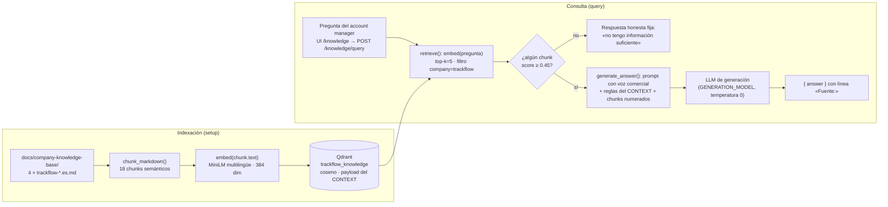

# Diseño del RAG de TrackFlow: base de conocimiento comercial

**Para quién:** desarrolladores que tengan que mantener o extender el asistente comercial sin leer antes el código.
**Ticket:** Hito 7. Miguel Torres (Director Comercial) quiere que sus 8 account managers y business developers respondan a marcas prospecto y clientes "como lo haría un vendedor de TrackFlow": con datos exactos y sin prometer condiciones que no estén en los acuerdos estándar.

## Resumen del stack

| Pieza | Elección | Dónde |
|---|---|---|
| Corpus | 4 documentos Markdown oficiales | `docs/company-knowledge-base/trackflow-*.es.md` |
| Chunking e indexación | `setup()`, `embed()` | `mock_data/process/rag.py` (el `data/process/` del enunciado) |
| Recuperación y generación | `retrieve()`, `generate_answer()`, `query()` | `mock_data/pipelines/rag.py` |
| Base vectorial | Qdrant 1.19, colección **`trackflow_knowledge`**, distancia coseno | servicio `qdrant` en `docker-compose.yml` |
| Embeddings | `sentence-transformers/paraphrase-multilingual-MiniLM-L12-v2` local (fastembed/ONNX), 384 dimensiones | `EMBEDDING_MODEL` |
| Generación | Cualquier LLM de chat con API compatible con OpenAI, configurado aparte | `LLM_API_URL`, `LLM_API_KEY`, `GENERATION_MODEL` |
| API | `POST /knowledge/query` → `{"answer": "..."}` | `services/api/routes/knowledge.py` |
| UI | Página "Asistente comercial" del backoffice | `uis/backoffice/src/app/knowledge/KnowledgeAssistant.tsx` (`/knowledge`) |
| Evaluación | Recall@3 y calibración de `min_score` | `scripts/evaluate_rag_retrieval.py`, `mock_data/eval/test-queries.json` |

No se usa ningún framework de orquestación (LangChain, LlamaIndex...): las funciones llaman directamente al SDK de Qdrant, a fastembed y al SDK `openai`.

## 1. Proceso RAG de extremo a extremo



**Indexación** (`uv run python -m mock_data.process.rag`):

1. `setup()` lee los cuatro documentos fuente de `docs/company-knowledge-base/` y comprueba que estén los cuatro (`sla-delivery`, `returns-policy`, `carrier-coverage`, `storage-pricing`) y que cada uno produzca al menos 3 chunks.
2. `chunk_markdown()` los divide en unidades semánticas (ver §2).
3. `embed()` genera el vector de cada chunk. La dimensión de la colección se toma del propio modelo, no está fijada en el código.
4. Se recrea la colección `trackflow_knowledge` con distancia coseno y se insertan los 18 puntos. El payload sigue el CONTEXT: `company`, `source_document`, `section`, `language`, `chunk_index` y `text`.

**Consulta:**

5. La UI llama a `POST /knowledge/query` con el token de sesión. El router valida la pregunta (3–1000 caracteres) y llama a `query()`. No contiene lógica de RAG propia.
6. `query()` es literalmente `generate_answer(question, retrieve(question, k=5, min_score=0.45))`. El futuro agente LangGraph puede llamar a `retrieve()` y a `generate_answer()` por separado.
7. `retrieve()` embebe la pregunta con la **misma** `embed()`, pide los 5 vecinos filtrando por `company = "trackflow"`, descarta los que tengan score < `min_score` y devuelve diccionarios planos con el payload y el score. Puede devolver menos de 5 resultados, o ninguno. Los scores se registran en el log del servidor y nunca se devuelven al cliente.
8. `generate_answer()`:
   - **Sin contexto:** devuelve una respuesta fija de "no tengo información suficiente" **sin llamar al LLM**, para que no pueda inventar un SLA ni una tarifa.
   - **Con contexto:** arma el prompt (sistema más chunks numerados con su `source_document` y `section`) y llama al modelo de generación con temperatura 0.
9. La API devuelve únicamente `{"answer": "..."}`. Nunca expone chunks, payloads ni puntuaciones.

### Prompt de generación

El mensaje de sistema fija la **voz y la audiencia del CONTEXT**: asistente interno para los account managers y el equipo de business development de Miguel Torres, que responde en español, de forma breve y con datos exactos, como un vendedor de TrackFlow en una llamada. Reglas obligatorias:

1. Usar **solo** el contexto. Si no responde la pregunta, decir "no tengo información suficiente en la base de conocimiento".
2. Copiar porcentajes, tarifas, monedas y plazos **literalmente**, sin redondear ni convertir (KPI de *faithfulness*).
3. **Descuentos de almacenamiento:** siempre requieren aprobación de **Miguel Torres**. **Excepciones de transportista:** siempre requieren aprobación de **Carlos Vega**. Nunca se ofrecen directamente.
4. **No garantizar SLA** en fechas de alta demanda (Black Friday, Navidad, Rebajas de enero): los tiempos pueden extenderse según el documento, y hay que avisar al cliente con antelación.
5. Las **devoluciones internacionales nunca son "automáticas"**: siempre se remiten a gestión manual del equipo de **Sofía Ramos**.
6. Terminar con una línea `Fuente: [n] source_document — section`, para que cada respuesta sea trazable a su documento.

## 2. Estrategia de chunking

**Tipo:** por unidad semántica, guiado por la estructura Markdown. No se usa tamaño fijo ni solapamiento.

Los documentos fuente son cortos (unos 1 KB cada uno) y no tienen subtítulos: solo un `# Título`, párrafos y listas. En ellos, **cada párrafo o viñeta es una regla de negocio completa** (una tarifa, un plazo, una condición con su excepción). Cortar por número de caracteres separaría justo lo que no se puede separar, por ejemplo "compensación del 5 %" de "si cae por debajo del 90 % durante dos meses consecutivos". Las reglas de `chunk_markdown()` son:

| Bloque del Markdown | Unidad de chunk | Por qué | Ejemplo |
|---|---|---|---|
| Párrafo independiente | 1 chunk | Es una regla completa, con su condición y su excepción | Compensación del 5 %; advertencia de alta demanda (+40 %) |
| Párrafo que termina en `:` | No es chunk: se **antepone** a cada chunk de la lista siguiente | Lleva la condición que aplica a toda la lista | "cobra… según volumen ocupado, no según número de unidades:" va delante de cada tarifa |
| Lista con viñetas `-` | 1 chunk por viñeta | Cada viñeta es una tarifa o un tipo de envío distinto | "Envío express: 24 a 48 horas… solo zonas metropolitanas…" |
| Lista numerada | 1 chunk con **todos** los pasos | Es un procedimiento; separar los pasos rompería el orden | Proceso de devolución en 3 pasos |
| Encabezado más viñetas | 1 chunk por bloque | Permite comparar los transportistas de un mismo país | "España (Zaragoza): MRW, SEUR…" con sus viñetas |

Además:

- **Normalización.** Las líneas cortadas por el ancho del Markdown se unen en frases completas, colapsando espacios.
- **Título como prefijo.** Cada chunk empieza con el título del documento ("SLA de Entrega", "Tarifas de Almacenamiento"…), para que se entienda fuera de contexto y su embedding sepa de qué política habla.
- **`section`.** Es `Título > etiqueta`. La etiqueta es el texto anterior a `:` cuando la regla lo tiene ("Ventana de devolución estándar", "Tarifa estándar") o, si no, la primera frase recortada. Los documentos no tienen subtítulos que reutilizar.
- **Idempotencia: limpiar y recargar más IDs deterministas.** Cada `setup()` borra y recrea la colección, así que nunca quedan duplicados ni chunks de una versión anterior de un documento. Recargar 18 chunks tarda segundos. Cada punto usa `uuid5(company/source_document/language/chunk_index)`, de modo que los IDs son estables y trazables entre ejecuciones. Está verificado: dos ejecuciones seguidas dan los mismos 18 IDs.

**Resultado:**

| Documento | Chunks | Caracteres (mín.–máx.) | Tokens MiniLM (máx.) |
|---|---|---|---|
| `sla-delivery` | 5 | 255–345 | 90 |
| `returns-policy` | 5 | 163–499 | 119 |
| `carrier-coverage` | 3 | 276–445 | 111 |
| `storage-pricing` | 5 | 232–308 | 74 |
| **Total** | **18** | | |

El modelo de embeddings solo lee **128 tokens**: lo que pase de ahí se trunca sin aviso. El chunk más largo (el procedimiento de devolución) ocupa 119, así que todos entran completos. Si se añaden documentos con párrafos más largos, hay que revisar esta tabla o cambiar de modelo.

**Garantías comprobadas en los tests** (`tests/pipelines/test_rag.py::test_chunks_keep_business_rules_whole`):

- la compensación del 5 % va junto a "dos meses consecutivos";
- la advertencia de alta demanda va entera (Black Friday, Rebajas de enero y +40 %);
- la tarifa preferencial va junto a "Miguel Torres";
- las devoluciones internacionales van junto a "gestión manual" y "Sofía Ramos";
- cada viñeta de tarifas conserva "según volumen ocupado".

## 3. Prácticas de embeddings

### Dos modelos, dos trabajos

| | Modelo | Dónde se usa |
|---|---|---|
| **Embeddings** | `sentence-transformers/paraphrase-multilingual-MiniLM-L12-v2`, local con fastembed (ONNX, CPU), sin clave ni coste | Solo `embed()`, al indexar y al consultar |
| **Generación** | El que indique `GENERATION_MODEL`, en una API de chat compatible con OpenAI (`LLM_API_URL`, `LLM_API_KEY`) | Solo `generate_answer()` |

- El equipo **no usa los LLM proporcionados por 4Geeks**. Por eso los embeddings se calculan en local y la generación se deja configurable por entorno, independiente del proveedor.
- `load_generation_settings()` **falla si `GENERATION_MODEL` coincide con `EMBEDDING_MODEL`**, así que es imposible reutilizar el modelo de generación para embeddings.
- `EMBEDDING_PROVIDER=openai` permite cambiar a una API de embeddings remota sin tocar el código, pero hay que reindexar y recalibrar el umbral.
- **Estado:** el LLM de generación todavía no está configurado en este entorno. Mientras falte, `POST /knowledge/query` responde 503 con un mensaje claro. La recuperación y su evaluación ya funcionan con el modelo real de embeddings.

### Por qué MiniLM multilingüe

- **Idioma.** El corpus y las preguntas están en español. Es un modelo de paráfrasis multilingüe (unos 50 idiomas) y **simétrico**: pregunta y documento se embeben igual, sin prefijos `query:` / `passage:`.
- **Tamaño.** 0,22 GB y 384 dimensiones. Carga en segundos en CPU y cabe en el contenedor del API, que también lo necesita para embeber cada pregunta.
- **Alternativa descartada.** Se probó `paraphrase-multilingual-mpnet-base-v2` (768 dimensiones, 1 GB). El proceso se terminó por memoria al cargarlo, dos veces, en el entorno de desarrollo (7,8 GB de RAM con unos 2 GB libres). Desplegarlo en cada contenedor del API tendría el mismo problema. Queda como mejora si hay un host con más memoria (ver §5).

### Consistencia indexado–consulta

- Hay **una sola función `embed()`**. `setup()` la llama para cada chunk y `retrieve()` para la pregunta: mismo modelo, mismo proveedor y mismo preprocesado.
- **Preprocesado:** `normalize_text()` colapsa espacios y saltos de línea y recorta. No se pasa a minúsculas ni se quitan acentos: el modelo es *cased* y los acentos aportan significado en español. En el indexado, el texto embebido es el mismo `text` que se guarda en el payload y llega al prompt.
- **Métrica:** distancia **coseno** en Qdrant. El score es la similitud coseno, entre −1 y 1.
- **Caché del modelo:** `EMBEDDING_CACHE_DIR`, por defecto `.cache/fastembed/` (ignorada en git). En compose, el backend la guarda en el volumen persistente `backend_data` (`/var/lib/trackflow/fastembed`). El modelo se carga una vez por proceso.

### Umbral `min_score = 0.45` y cómo se afinó

Con `scripts/evaluate_rag_retrieval.py` sobre `mock_data/eval/test-queries.json` (17 preguntas dentro del alcance y 6 fuera) se recorrieron todos los umbrales de 0,00 a 1,00. El criterio fue elegir **el umbral más alto que no pierda ningún acierto de Recall@3**, es decir, el mayor que deja pasar todos los chunks correctos que el ranking ya pone en el top-3.

| `min_score` | Recall@3 con umbral | Rechazo de preguntas fuera de alcance |
|---|---|---|
| 0,40 | 82 % | 50 % |
| **0,45 (elegido)** | **82 %** | **50 %** |
| 0,50 (valor provisional anterior) | 76 % ✗ (por debajo del KPI) | 50 % |
| 0,55 | 71 % ✗ | 67 % |
| 0,60 | 35 % ✗ | 83 % |

- **0,45 es el único valor que cumple el KPI del 80 %.** El acierto con score más bajo es `storage-02` (0,458).
- **Un rechazo del 50 % es la limitación conocida del modelo.** Tres preguntas fuera de alcance puntúan alto por coincidencia léxica:
  - "precio de la acción en bolsa" llega a 0,736 contra la tarifa de almacenamiento ("precio", "cuesta");
  - "seguro de mercancía en los envíos" llega a 0,577 contra los transportistas;
  - "horario de atención" llega a 0,537.

  En esos casos el umbral no basta, y la segunda barrera es la regla 1 del prompt: el contexto (tarifas de almacenamiento) no responde la pregunta, así que el modelo debe decir que no tiene información.
- **El umbral depende del modelo.** Si se cambia `EMBEDDING_MODEL`, hay que reindexar, ejecutar la evaluación y actualizar `RAG_MIN_SCORE`. El script propone el nuevo valor.

## 4. Evaluación de recuperación: Recall@3

`uv run python scripts/evaluate_rag_retrieval.py`. El resultado completo, con el top-3 de cada pregunta y el barrido de umbrales, está en `mock_data/eval/rag-retrieval-eval.json`.

| Métrica | Valor | KPI del CONTEXT |
|---|---|---|
| Recall@3 sin umbral | **82 %** (14/17) | — |
| Recall@3 con `min_score = 0.45` | **82 %** (14/17) | ≥ 80 % ✅ |
| Cobertura | sla-delivery 6, returns-policy 4, carrier-coverage 3, storage-pricing 4 | los 4 documentos ✅ |
| Preguntas de alta demanda | `sla-02` (Black Friday) y `sla-03` (Rebajas de enero): ambas en rango 1 | al menos 1 ✅ |

Las preguntas imitan cómo hablaría un account manager y **no copian el texto** de los documentos. Por ejemplo: "¿qué se cobra por el stock que lleva más de seis meses sin venderse?" frente al texto "más de 180 días sin movimiento".

**Fallos y lo que indican:**

| Pregunta | Esperado | Qué recuperó | Lectura |
|---|---|---|---|
| `sla-04` "¿Qué compensación recibe la marca si no cumplimos el porcentaje de entregas a tiempo?" | `sla-delivery#3` | Chunks de devoluciones y tarifas ("recibe", "marca") | "Compensación" y "entregas a tiempo" sí están en el chunk. Probablemente el modelo de paráfrasis pondera más la estructura "la marca recibe/asume" que esos términos. Es un caso típico para búsqueda híbrida |
| `returns-03` "Un comprador de EE. UU. quiere devolver desde España, ¿se tramita solo?" | `returns-policy#3` | `returns-policy#2` (costes) | Paráfrasis fuerte: "se tramita solo" frente a "proceso automático estándar". El documento es el correcto, pero no el chunk |
| `returns-04` "¿Qué pasos sigue una devolución…?" | `returns-policy#0` (rango 4, score 0,557) | Ventana y costes de devolución | El chunk del procedimiento es el más largo (119 tokens) y su embedding queda más difuso |

## 5. Limitaciones y siguientes pasos

1. **Configurar el LLM de generación** (`LLM_API_URL`, `LLM_API_KEY`, `GENERATION_MODEL`) y revisar de forma manual la *faithfulness* de las respuestas para las 17 preguntas: ningún porcentaje, tarifa ni plazo debe diferir del chunk citado.
2. **Búsqueda híbrida** (vector denso + BM25 disperso, ambos con fastembed y fusión en Qdrant). Es la mejora con más impacto esperado sobre `sla-04` y sobre el rechazo de preguntas fuera de alcance, porque el BM25 premia términos exactos como "compensación" o "internacional".
3. **Modelo de embeddings mayor** (mpnet o `multilingual-e5-large`) en un host con más memoria. Requiere reindexar y recalibrar el umbral.
4. **Más preguntas de evaluación:** con 17 preguntas, cada fallo mueve el Recall@3 unos 6 puntos y el resultado (82 %) está cerca del umbral del KPI.

## 6. Operación

```bash
# Qdrant (con compose, o un contenedor suelto en desarrollo)
docker compose up -d qdrant        # requiere .env
# Indexar (idempotente) y evaluar
uv run python -m mock_data.process.rag
uv run python scripts/evaluate_rag_retrieval.py
# Tests (sin Qdrant ni LLM: usan stubs y Qdrant en memoria)
uv run pytest tests/pipelines/test_rag.py tests/pipelines/test_rag_eval.py -q
```

| Variable | Valor por defecto | Uso |
|---|---|---|
| `QDRANT_URL` / `QDRANT_API_KEY` | `http://localhost:6333` / — | Conexión a Qdrant (en compose: `http://qdrant:6333`) |
| `EMBEDDING_PROVIDER` | `fastembed` | `fastembed` (local) u `openai` (API remota) |
| `EMBEDDING_MODEL` | `sentence-transformers/paraphrase-multilingual-MiniLM-L12-v2` | Modelo de embeddings |
| `EMBEDDING_CACHE_DIR` | `.cache/fastembed` | Caché del modelo local |
| `LLM_API_URL` / `LLM_API_KEY` / `GENERATION_MODEL` | — (obligatorias para generar) | LLM de generación compatible con OpenAI |
| `RAG_MIN_SCORE` | `0.45` | Umbral de similitud calibrado |
| `RAG_TOP_K` | `5` | Vecinos que `query()` pide a Qdrant |
