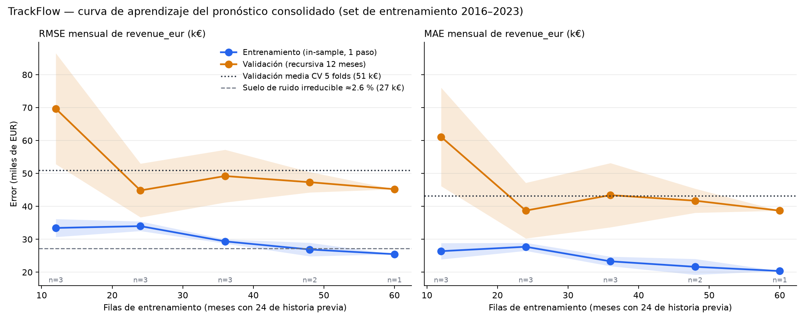

# Evaluación técnica: pronóstico de ingresos consolidados de TrackFlow

**Para:** tech lead (ticket de paso a staging). **Fecha:** 2026-11-19.
**Modelo evaluado:** `scripts/train_sales_forecast.py`. Es un Random Forest que predice el crecimiento interanual `log(revenue_eur_t / revenue_eur_{t-12})` de la fila `market = "consolidated"`. Usa features causales de lags, rodantes y calendario, y pronostica de forma recursiva.
**Reproducir:** `uv run python scripts/evaluate_sales_forecast.py`. Las salidas están en `mock_data/eval/`: `cv_metrics.json`, `learning_curve.json` y `learning_curve.png`.

## Respuestas al ticket

| Pregunta | Respuesta |
|---|---|
| ¿Underfitting, overfitting o bien ajustado? | **Underfitting (sesgo) localizado en el nivel anual de ingresos.** No hay overfitting: el error de entrenamiento (2,65 %) está en el suelo de ruido irreducible de la serie (2,57 %), no por debajo. El error de validación (4,89 %) se estanca por encima de ese suelo aunque crezca el entrenamiento, y su componente dominante es un sesgo sistemático que cambia de signo con el crecimiento alterno del dataset. |
| ¿Qué tan estable es si cambia la porción de entrenamiento? | **RMSE de validación de 50.898 ± 12.818 EUR (4,89 ± 1,60 %)** en 5 folds. La dispersión se concentra en el fold 1, con solo 12 filas de entrenamiento (7,66 %). Con 24 filas o más, los folds 2–5 quedan entre 3,76 % y 4,69 % (4,20 ± 0,48 %). El RMSE del set de prueba 2024–2025 del proyecto anterior (3,67 %) cae dentro de ese rango. |
| ¿Acción correctiva específica? | **Anclar el total anual del pronóstico al crecimiento de hace dos años** (patrón alterno X±Y del CONTEXT) y usar el Random Forest solo para el perfil mensual. En los mismos 5 folds, el RMSE baja de 50.898 ± 12.818 a **39.339 ± 5.007 EUR** y el MAE de 43.149 ± 11.697 a **33.218 ± 5.561 EUR**. |

## 1. Datos, split y protocolo sin fuga

- **Datos.** `mock_data/raw/trackflow_sales.csv` (el `data/raw/` del CONTEXT), con las columnas `month`, `revenue_eur`, `shipments_processed`, `avg_revenue_per_shipment_eur` y `market`. Se usan las filas `consolidated`, de 2016-01 a 2025-12.
- **Split anterior, conservado y reproducible.** Entrenamiento 2016–2023 (96 meses) y prueba 2024–2025 (24 meses). Al volver a ejecutar el entrenamiento se obtienen las mismas métricas de prueba (RMSE 3,67 % del ingreso medio, K2 0,92, Gini 0,93), con diferencias solo de redondeo en el decimal 15. **Esta evaluación no toca 2024–2025:** todo se hace dentro de 2016–2023.
- **Validación cruzada temporal.** `TimeSeriesSplit(n_splits=5, test_size=12)` sobre los 96 meses de entrenamiento, con ventana expansiva y sin shuffle. Cada fold valida un año natural completo (2019, 2020, 2021, 2022 y 2023). Así cada validación incluye el pico de noviembre–diciembre y la caída de febrero, que son los meses que más importan al negocio.
- **Orden cronológico verificado.** `assert_chronological_folds()` falla si algún fold no es un bloque contiguo y ordenado, si la validación no sigue inmediatamente al entrenamiento o si un fold posterior precede o se solapa con uno anterior. El test `tests/pipelines/test_sales_forecast_evaluation.py` lo comprueba y verifica que unos folds barajados (`KFold(shuffle=True)`) se rechazan.
- **Sin fuga en lags y rodantes en el borde de cada fold.** Si las features se calcularan sobre la serie completa antes de dividir, el `lag_1` del segundo mes de validación sería el ingreso real del primer mes de validación. Para evitarlo, en cada fold:
  1. se corta la serie en el inicio de la validación, y la imputación y la matriz de entrenamiento usan solo los meses anteriores;
  2. los 12 meses de validación se pronostican de forma recursiva, usando como historia el entrenamiento y las predicciones propias, nunca un valor real de validación.

  Un test multiplica por 50 los ingresos del fold de validación y comprueba que ni el ajuste ni las 12 predicciones cambian.
- **Asimetría declarada.** El error de entrenamiento es in-sample a un paso: cada fila conoce sus lags reales. El de validación es recursivo a 12 meses, que es como se usa el modelo. Parte del hueco entre ambos se debe al horizonte, no a sobreajuste. El apartado 4 separa los componentes.

## 2. MAE y RMSE por fold (EUR, `revenue_eur` mensual)

| Fold | Entrenamiento | Filas | Valida | MAE train | RMSE train | MAE val | RMSE val | RMSE val % | Sesgo medio val | Mayor error |Nov–Dic| |
|---|---|---|---|---|---|---|---|---|---|---|
| 1 | 2016-01 → 2018-12 | 12 | 2019 | 11.615 | 13.760 | 62.832 | 73.107 | 7,66 % | −60.138 | 107.300 |
| 2 | 2016-01 → 2019-12 | 24 | 2020 | 25.415 | 30.300 | 36.421 | 46.056 | 4,69 % | +24.373 | 86.966 |
| 3 | 2016-01 → 2020-12 | 36 | 2021 | 23.071 | 29.380 | 33.485 | 40.583 | 3,82 % | −22.801 | 74.346 |
| 4 | 2016-01 → 2021-12 | 48 | 2022 | 19.938 | 25.443 | 44.309 | 49.528 | 4,54 % | +36.816 | 48.453 |
| 5 | 2016-01 → 2022-12 | 60 | 2023 | 20.355 | 25.474 | 38.695 | 45.217 | 3,76 % | −20.821 | 74.306 |

"Filas" son los meses de entrenamiento que tienen 24 meses de historia previa, necesarios para todas las features.

**Media ± desviación estándar entre folds:**

| | MAE | RMSE |
|---|---|---|
| Entrenamiento | 20.079 ± 5.224 EUR (2,14 ± 0,54 %) | 24.871 ± 6.595 EUR (2,65 ± 0,68 %) |
| Validación | 43.149 ± 11.697 EUR (4,14 ± 1,41 %) | **50.898 ± 12.818 EUR (4,89 ± 1,60 %)** |

## 3. Qué métrica refleja mejor el costo de negocio: RMSE

Se reportan las dos, pero **la métrica de decisión es el RMSE**, por tres razones que salen del SALES-FORECAST-MODEL-CONTEXT:

1. **El CONTEXT pide el MSE** en EUR² y como porcentaje del ingreso mensual promedio. El RMSE es su raíz, en EUR. Con él Thomas y Ana pueden interpretar directamente la misma función de pérdida que se pidió reportar, y optimizar o comparar con MAE sería evaluar el modelo con otro criterio.
2. **El negocio factura por volumen y tiene picos muy marcados.** Noviembre y diciembre están un 25–35 % por encima del promedio por Black Friday y Navidad, y febrero un 10–15 % por debajo. Ana (Almacén) y Carlos (Carriers) planifican capacidad para esos picos. Un error grande en un mes pico (hasta 107 k€ en noviembre–diciembre de 2019) obliga a dimensionar operarios y transportistas para un volumen equivocado justo cuando no hay margen. Un error de 100 k€ en diciembre es más grave para la operación que diez errores de 10 k€ repartidos en meses tranquilos. El RMSE penaliza los errores de forma cuadrática y recoge esa asimetría; el MAE los trata linealmente y los diluiría. En la CV, noviembre y diciembre son el 16,7 % de los meses validados, pero aportan el 22,9 % del error cuadrático y el 20,2 % del absoluto.
3. **Gini y detección de anomalías.** Thomas quiere distinguir un febrero bajo normal de una caída atípica que merezca investigación. Un único mes mal pronosticado por mucho es justo lo que generaría una falsa alarma o taparía una caída real, y es lo que el RMSE castiga y el MAE suaviza.

El MAE se mantiene como métrica de comunicación: "en un mes típico nos desviamos unos 43 k€, un 4,1 %". El cociente RMSE/MAE de validación (1,18) indica que el error no lo dominan unos pocos meses extremos, sino un desplazamiento sostenido. Eso encaja con el diagnóstico de sesgo del apartado 4.

## 4. Diagnóstico: underfitting localizado en el nivel anual

### Curva de aprendizaje

**Construcción.** Para cada tamaño de ventana de 36, 48, 60, 72 y 84 meses (de 12 a 60 filas), el modelo se entrena con los meses inmediatamente anteriores a un año de validación (2021, 2022 o 2023) y valida ese año de forma recursiva. El tamaño crece sin alejar la validación del corte. Cada punto es la media sobre los años disponibles, indicados con `n` en la gráfica, y la banda es ± una desviación estándar. Los valores están en `learning_curve.json`.

| Filas de entrenamiento | RMSE train | RMSE val (media ± desv.) | MAE train | MAE val |
|---|---|---|---|---|
| 12 | 33.439 | 69.685 ± 16.856 | 26.384 | 61.119 |
| 24 | 33.988 | 44.839 ± 8.155 | 27.720 | 38.710 |
| 36 | 29.357 | 49.208 ± 8.000 | 23.299 | 43.408 |
| 48 | 26.895 | 47.336 ± 3.100 | 21.635 | 41.718 |
| 60 | 25.474 | 45.217 (n=1) | 20.355 | 38.695 |

### Evidencia

1. **No hay overfitting.** El ruido mensual irreducible de la serie se estima en **2,57 %**, unos 27 k€ a la escala de 2019–2023. Es la desviación del log de `revenue_eur` tras quitar el nivel de cada año y el perfil de cada mes, y corresponde a la fluctuación de ±5 % que describe el CONTEXT. El error de entrenamiento converge a ese suelo (25,5 k€ con 60 filas, 0,94 veces el suelo) sin perforarlo. Un modelo sobreajustado memorizaría el ruido: su error de entrenamiento caería muy por debajo del suelo y el de validación empeoraría al añadir complejidad. Nada de eso ocurre. El ligero 6 % por debajo del suelo es el optimismo esperable de evaluar in-sample un bosque con `min_samples_leaf=3`.
2. **La validación se estanca por encima del suelo y el hueco no se cierra con más datos.** La validación cae de 69,7 k€ a 44,8 k€ entre 12 y 24 filas y luego queda plana entre 45 y 49 k€. Su dispersión baja de 16,9 k€ a 3,1 k€. Una curva de validación plana, con un hueco que no se cierra, señala sesgo y no varianza. Por eso "añadir más datos" no corregiría el problema, aunque hubiera más años disponibles.
3. **El error de validación es un sesgo de nivel anual que se alterna con el patrón de crecimiento del CONTEXT.** El crecimiento anual real alterna entre X+Y y X−Y (9,58 %, 1,82 %, 9,42 %, 2,92 %, 8,03 %, 2,80 %, 10,12 %…). En el origen del pronóstico, el modelo predice algo cercano a la media reciente:

   | Año validado | Crecimiento real | Crecimiento implícito del modelo | Sesgo medio | Parte del MSE que es sesgo |
   |---|---|---|---|---|
   | 2019 | 9,42 % | 2,53 % | −6,30 % | 68 % |
   | 2020 | 2,92 % | 5,47 % | +2,48 % | 28 % |
   | 2021 | 8,03 % | 5,71 % | −2,15 % | 32 % |
   | 2022 | 2,80 % | 6,27 % | +3,37 % | 55 % |
   | 2023 | 10,12 % | 8,21 % | −1,73 % | 21 % |

   El sesgo cambia de signo cada año, exactamente como el crecimiento. En los años de crecimiento alto el modelo subestima y en los bajos sobreestima.

**Clasificación: underfitting (alto sesgo), localizado en la componente de nivel o crecimiento anual.** No es un underfitting global. El modelo captura bien la estacionalidad: noviembre–diciembre y febrero dentro de cada año, y en la prueba 2024–2025 Gini 0,93 y K2 0,92. Además, mejora claramente a la referencia ingenua "repetir el año anterior" (9,5 % frente a 3,7 % en prueba).

### Causa raíz

Al pronosticar desde enero, las features de crecimiento disponibles (`yoy_growth_lag_1` y `yoy_growth_trailing_12`) describen el año que acaba de terminar. Con un crecimiento alterno, ese dato está **anticorrelacionado** con el crecimiento del año que se va a pronosticar. Sin una señal que codifique la alternancia, el Random Forest regresa hacia la media (5–6 %), y como el pronóstico es recursivo, ese error de nivel se arrastra los 12 meses.

Este diagnóstico se comprobó con dos experimentos exploratorios. Se ejecutaron sobre los mismos folds, pero no forman parte del script; el script solo reproduce la acción correctiva:

- **Añadir el crecimiento de hace dos años como una feature más no basta.** Con `MIN_HISTORY = 36`, el RMSE de validación fue de 7,57 %, 3,51 %, 4,90 % y 3,69 % en 2020–2023, sin una mejora consistente. Con 24–60 filas, el bosque no aprende la interacción a partir de una columna entre nueve.
- **Repetir el crecimiento del año anterior empeora el resultado** (6,1–8,2 % de RMSE), mientras que usar el de hace dos años da 4,1–4,7 %. Eso confirma que la estructura es alterna y no persistente.

## 5. Acción correctiva propuesta

**Separar el nivel anual de la forma mensual.**

1. **Nivel.** El total del año Y se ancla a `revenue_eur(Y−1) · (1 + g(Y−2))`, donde `g(Y−2)` es el crecimiento real de hace dos años. Es causal: solo usa años completos anteriores al origen del pronóstico. Codifica explícitamente el patrón X±Y del CONTEXT (`alternating_growth_anchor()` en `scripts/evaluate_sales_forecast.py`).
2. **Forma.** El Random Forest actual se mantiene y aporta solo el reparto mensual: el pico de noviembre–diciembre, la caída de febrero y el ±5 % restante. Su pronóstico de 12 meses se reescala para que sume el ancla anual.

**Resultado en los mismos 5 folds, sin tocar 2024–2025** (`corrective_experiment` en `cv_metrics.json`):

| Año validado | RMSE actual | RMSE con ancla | MAE actual | MAE con ancla |
|---|---|---|---|---|
| 2019 | 73.107 | 41.553 | 62.832 | 37.085 |
| 2020 | 46.056 | 39.940 | 36.421 | 34.014 |
| 2021 | 40.583 | 35.604 | 33.485 | 29.316 |
| 2022 | 49.528 | 33.450 | 44.309 | 26.035 |
| 2023 | 45.217 | 46.148 | 38.695 | 39.642 |
| **Media ± desv.** | **50.898 ± 12.818** | **39.339 ± 5.007** | **43.149 ± 11.697** | **33.218 ± 5.561** |

El RMSE mejora un 23 % de media y la dispersión entre folds se reduce a menos de la mitad. Es decir, el modelo es más preciso y también más estable ante cambios en la porción de entrenamiento. Mejora en 4 de 5 años; en 2023 empeora ligeramente (+0,9 k€), porque ese año creció un 10,1 %, por encima del 8 % del año ancla.

**Riesgos y condiciones antes de adoptarlo:**

- **Depende de que la alternancia continúe.** La regla debe ir acompañada de un control anual: si el signo de `g(Y−1) − g(Y−2)` deja de alternar, se vuelve al nivel del Random Forest. Si cambia la mezcla Los Ángeles/Zaragoza (PSI del proyecto anterior), se revisa la regla antes de confiar en ella.
- **Horizonte de 24 meses.** En la prueba 2024–2025, el segundo año (2025) se anclaría sobre el total pronosticado de 2024 y el crecimiento real de 2023. Ese encadenamiento debe validarse en CV con horizonte de 24 meses antes de evaluarlo una sola vez en la prueba.
- **Orden de los pasos.** Primero se implementa como opción en `scripts/train_sales_forecast.py`, después se repite esta CV y solo al final se hace una única evaluación sobre 2024–2025. No se ha usado el set de prueba para elegir la acción.

## 6. Recomendación al ticket

**No promover el modelo actual a staging tal cual.** No está sobreajustado y su forma mensual es buena, pero tiene un sesgo de nivel anual sistemático. Con el set de entrenamiento disponible, ese sesgo explica entre el 21 % y el 68 % del error de validación de cada año. La acción del apartado 5 ataca esa causa raíz y reduce el RMSE de validación de 4,89 ± 1,60 % a unos 3,7 ± 0,5 %. Se recomienda implementarla y volver a evaluar antes de aprobar el paso.
