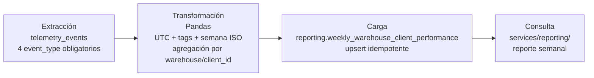

# Pipeline de desempeño de negocio de TrackFlow

## Current State

### Eventos capturados y almacenamiento

TrackFlow ya cuenta con un catálogo de telemetría y una captura por lotes desde el backoffice. Los eventos se validan contra el contrato de `docs/telemetry/event-schemas.json` y se reciben mediante `POST /telemetry/events`.

Los eventos persistidos hasta ahora cubren estas dimensiones técnicas y operativas:

- Inventario: `inbound_order_created`, `outbound_order_created`, `stock_threshold_triggered`, `direct_stock_edit_rejected`, `inventory_discrepancy_detected` e `inventory_stock_loss_recorded`.
- Autenticación: `login_attempted`, `login_succeeded`, `login_failed` y `session_expired`.
- Uso y fiabilidad: `backoffice_section_viewed`, `api_request_completed`, `frontend_unhandled_error`, `frontend_retry_requested` y `frontend_web_vital_recorded`.

El backend almacena los eventos en la tabla `public.telemetry_events` de Supabase mediante el modelo `TelemetryEventRecord`. Cada fila conserva el timestamp UTC, el tipo de evento, los identificadores de correlación y el payload operacional validado en `tags`. Esta tabla es la fuente de solo lectura para el pipeline de desempeño; el pipeline no escribirá resultados en ella.

### Reporte técnico existente

El módulo `services/telemetry/analysis.py` transforma los eventos con Pandas y produce listas serializables para:

- volumen de eventos por día y tipo;
- tasa de errores por día;
- tasa diaria de fallos de autenticación;
- latencia por ruta;
- tipos de evento dominantes.

`GET /telemetry/report` resuelve una ventana explícita o los últimos siete días UTC, ejecuta las métricas técnicas y devuelve `period` junto con `metrics`. Su caché en memoria tiene un TTL de 60 segundos. Este reporte está orientado al equipo de ingeniería: responde cómo se comporta el sistema, no cómo rinde la operación logística frente a sus objetivos de negocio.

### Brecha que requiere un pipeline dedicado

El reporte técnico actual no responde la pregunta de negocio que necesitan Thomas y Ana: **¿cómo funcionó cada almacén para cada cliente durante una semana completa, en términos de volumen procesado y precisión del inventario?**

En particular, no consolida los cuatro KPIs definidos por el contexto:

1. volumen de entrada en unidades;
2. throughput de salida en pedidos;
3. frecuencia de quiebre de stock;
4. tasa de discrepancia de inventario.

Para responderla se necesita un pipeline separado que lea únicamente los cuatro eventos obligatorios de inventario, agregue por `warehouse`, `client_id` y semana ISO (`week_start`, UTC), y escriba resultados idempotentes en `reporting.weekly_warehouse_client_performance`. La frecuencia debe ser semanal, con un consolidado fresco el lunes, y la audiencia son Thomas (CEO) y Ana (Head of Warehouse Operations), no el equipo de ingeniería.

## Diseño del pipeline

### Propósito

**Producir semanalmente el Reporte Semanal de Desempeño por Almacén y Cliente para Thomas y Ana, calculando volumen de entrada, throughput de salida, frecuencia de quiebre de stock y tasa de discrepancia a partir de `inbound_order_created`, `outbound_order_created`, `stock_threshold_triggered` e `inventory_discrepancy_detected`.**

### Extracción y formato de entrada

La fuente principal es `public.telemetry_events`, consultada en modo solo lectura desde `services/reporting/`. La extracción seleccionará únicamente los cuatro `event_type` obligatorios y limitará el rango a la semana ISO solicitada en UTC.

El formato de llegada es una fila por evento:

| Columna | Uso en el pipeline |
|---|---|
| `event_id` | Identidad única para deduplicar y auditar la extracción. |
| `timestamp` | Fecha/hora UTC; se convierte a `datetime` antes de derivar `week_start`. |
| `event_type` | Selecciona el KPI y la operación de agregación. |
| `tags` | JSON con `warehouse`, `client_id` y, según el evento, `quantity` y `threshold`. |

El pipeline se ejecutará semanalmente antes del reporte del lunes y aceptará un disparo manual para reprocesar una semana concreta. La extracción no depende de que los eventos se inserten una sola vez: puede volver a leer la misma ventana para corregir o reconstruir el consolidado.

### Flujo de datos



#### Extracción

1. Resolver `week_start` como el lunes de la semana ISO en UTC.
2. Leer de `telemetry_events` los eventos cuyo `timestamp` pertenece a `[week_start, week_start + 7 días)`.
3. Filtrar en SQL por los cuatro tipos obligatorios.
4. Proyectar `event_id`, `timestamp`, `event_type` y `tags`; no leer ni copiar payloads fuera del catálogo.

#### Transformación

1. Convertir `timestamp` con `pd.to_datetime(..., utc=True)`.
2. Extraer de `tags` las dimensiones `warehouse` y `client_id`.
3. Convertir `quantity` a entero para los eventos de entrada y validar que sea no negativo.
4. Derivar `week_start` como fecha del lunes ISO en UTC.
5. Agrupar por `warehouse`, `client_id` y `week_start`.
6. Calcular:
   - suma de `quantity` para `inbound_order_created`;
   - conteo de `outbound_order_created`;
   - conteo de `stock_threshold_triggered`;
   - conteo de `inventory_discrepancy_detected`;
   - `discrepancy_rate = discrepancy_events_count / outbound_orders_count`, con cero cuando no haya salidas.

Los registros con dimensiones obligatorias ausentes o inválidas se rechazarán de forma explícita y se registrarán en el estado de la corrida; nunca se agruparán bajo un cliente o almacén inventado.

#### Carga

La transformación producirá una fila por combinación `warehouse` + `client_id` + `week_start` y hará `upsert` en `reporting.weekly_warehouse_client_performance`. La carga no escribirá en `telemetry_events`.

### Idempotencia y actualizaciones

Aunque `telemetry_events` normalmente inserta eventos, una relectura puede incluir el mismo `event_id` o una corrección del payload de un evento existente. La extracción deduplicará por `event_id`, conservando la versión más reciente disponible del registro antes de agregar. Después, la carga usará la restricción única `(warehouse, client_id, week_start)` y un `INSERT ... ON CONFLICT ... DO UPDATE` para reemplazar todos los campos calculados de esa combinación.

Por tanto, repetir una corrida para la misma semana no suma resultados anteriores: reconstruye la semana desde la fuente y sustituye el snapshot completo. Si una corrección mueve un evento entre clientes, almacenes o cantidades, el `upsert` actualiza la nueva combinación y la corrida elimina primero las filas de esa semana que ya no aparecen en el resultado, evitando residuos de una versión anterior.

### Destino y superficies de reporting

La tabla nueva exacta será:

`reporting.weekly_warehouse_client_performance`

El módulo nuevo y separado será `services/reporting/`. Sus endpoints serán:

- `GET /reporting/weekly-warehouse-client-performance`: consulta las filas KPI de una `week_start`, usando la semana más reciente si no se proporciona.
- `GET /reporting/pipeline-runs/latest`: expone estado, timestamps, semana procesada, filas escritas y errores de la última corrida.
- `POST /reporting/pipeline-runs`: dispara manualmente una corrida, opcionalmente para una `week_start` concreta.

Estas superficies no reutilizan `telemetry_events` como destino, no modifican `services/telemetry/analysis.py` y permanecen separadas de `GET /telemetry/report`, que continúa siendo el reporte técnico para ingeniería.

## Resiliencia e idempotencia

### Estrategia ante fallos durante la carga

La corrida se serializará por `week_start`: antes de extraer datos, el flow intenta adquirir un advisory lock de sesión no bloqueante cuya clave incluye el nombre del pipeline y la semana ISO. Si otro flow ya lo mantiene, la nueva corrida se registra como `skipped` con `error_message = "already_running"` y no ejecuta el ETL. La conexión que mantiene el lock se cierra al terminar o fallar el flow, liberándolo también si el proceso se interrumpe. La task de carga conserva además un advisory lock transaccional mientras modifica el destino.

La fase de carga se ejecutará dentro de una única transacción de base de datos:

1. Crear una tabla temporal de staging ligada a la transacción con las filas ya agregadas y validadas.
2. Comparar que las dimensiones y los contadores sean válidos.
3. Eliminar del destino las filas de la semana que no estén en el staging.
4. Ejecutar `INSERT ... ON CONFLICT (warehouse, client_id, week_start) DO UPDATE` desde staging.
5. Actualizar los contadores y el estado de la corrida.
6. Confirmar con `COMMIT` solo si todas las operaciones anteriores terminan correctamente.

Si ocurre un error en cualquiera de esos pasos, se ejecuta `ROLLBACK`: no quedan filas nuevas, actualizaciones parciales ni eliminaciones de la versión anterior. El estado de la corrida se marca como `failed` en una operación separada y conserva el error sanitizado; el siguiente intento vuelve a leer la fuente y reconstruye la semana completa.

Si el proceso pierde la conexión justo después del `COMMIT`, una nueva corrida puede encontrar un estado `unknown` en el log, pero no duplica datos: recalcula el mismo snapshot y el `upsert` reemplaza las mismas claves únicas. Si la corrida anterior realmente confirmó, el resultado permanece correcto; si no confirmó, la transacción anterior fue revertida. Nunca se suman los resultados de una corrida al resultado anterior.

La combinación de:

- clave única `(warehouse, client_id, week_start)`;
- reconstrucción completa de la semana;
- staging temporal;
- `upsert` determinista;
- eliminación de filas obsoletas dentro de la misma transacción;
- lock por `week_start`;

garantiza que repetir una corrida después de un fallo no corrompe ni duplica el consolidado.

### Log de ejecución

El pipeline registrará cada intento en una tabla separada `reporting.pipeline_runs`. Como mínimo, cada corrida tendrá:

| Campo | Tipo de dato | Motivo de auditoría |
|---|---|---|
| `run_id` | `uuid` | Identifica de forma única la corrida. |
| `prefect_run_id` | `uuid nullable` | Vincula la fila de reporting con la corrida nativa de Prefect. |
| `pipeline_name` | `text` | Distingue este pipeline de otros. |
| `week_start` | `date` | Indica la semana ISO procesada. |
| `started_at` | `timestamptz` | Registra cuándo comenzó la corrida. |
| `finished_at` | `timestamptz nullable` | Registra cuándo terminó la corrida. |
| `status` | `text` | Estado: `running`, `succeeded`, `failed`, `unknown` o `skipped`. |
| `records_read` | `integer` | Eventos leídos desde `telemetry_events`. |
| `records_transformed` | `integer` | Eventos válidos transformados. |
| `records_written` | `integer` | Filas escritas en la tabla de reporting. |
| `error_message` | `text nullable` | Error sanitizado de la corrida. |
| `trigger` | `text` | Origen: `scheduled`, `manual` o `late_event`. |
| `phase` | `text` | Fase actual: `extracting`, `transforming`, `loading` o `completed`. |
| `last_checkpoint_at` | `timestamptz nullable` | Último checkpoint persistido para recuperar la corrida. |

`started_at`, `finished_at` y `computed_at` se almacenarán en UTC. El estado `running` se escribe al comenzar; al completar la transacción pasa a `succeeded`. Si la carga falla, la actualización posterior registra `failed`; si no se puede determinar si el commit llegó a la base de datos, se conserva `unknown` para forzar una revisión o reintento seguro. El endpoint `GET /reporting/pipeline-runs/latest` expondrá estos campos sin incluir errores crudos, credenciales ni datos de los eventos.

## Mapeo a Prefect

### Flow principal

El flow principal será `weekly_warehouse_client_performance_flow(week_start=None, trigger="scheduled")`; `trigger` admite `scheduled`, `manual` o `late_event`. Si no recibe `week_start`, resolverá la semana ISO más reciente cerrada en UTC. Se ejecutará semanalmente antes del reporte del lunes y también podrá invocarse desde `POST /reporting/pipeline-runs` para reprocesar una semana concreta.

El flow coordinará las tasks en orden, pasará el `week_start` como parámetro explícito y registrará el `run_id` nativo de Prefect en `prefect_run_id`, separado del `run_id` propio de `reporting.pipeline_runs`. El lock de sesión evita ETL simultáneo para la misma semana; la transacción de carga sigue siendo responsabilidad de la task y de la base de datos. Prefect orquesta y observa, pero no sustituye la atomicidad del destino.

### Frecuencia y ejecución desde CLI

El ciclo previsto es semanal, cada lunes por la mañana, para que el reporte ejecutivo tenga los datos de la última semana ISO completa, delimitada en UTC. El deployment de Prefect debe fijar la hora exacta y su zona horaria.

Desde la raíz del repositorio, el script ejecuta el flow con la última semana cerrada:

```bash
python mock_data/pipelines/pipeline.py
```

Para reprocesar manualmente una semana concreta:

```bash
python mock_data/pipelines/pipeline.py --week-start 2026-11-09 --trigger manual
```

El argumento `--trigger` también acepta `scheduled` y `late_event`.

En este checkout, `mock_data/pipelines/` es la ruta equivalente a `data/pipelines/`. El proceso requiere Prefect 3, Pandas y las variables `REPORTING_READ_DATABASE_URL` y `REPORTING_WRITE_DATABASE_URL`.

### Tasks

1. **`extract_telemetry_events`**
   - Recibe `week_start` y el block de conexión de solo lectura.
   - Ejecuta la consulta SQL filtrada a los cuatro `event_type` obligatorios y a la ventana `[week_start, week_start + 7 días)`.
   - Devuelve un lote estructurado con `event_id`, `timestamp`, `event_type` y `tags`.
   - Registra `records_read`; aplica reintentos para errores transitorios de red sin reintentar silenciosamente errores de esquema o autorización.

2. **`transform_weekly_performance`**
   - Recibe el lote extraído y `week_start`.
   - Convierte timestamps a UTC, valida dimensiones y cantidades, deduplica por `event_id` y calcula los cinco campos derivados del snapshot.
   - Devuelve filas listas para staging y contadores de `records_transformed` y rechazados.
   - No escribe en Supabase ni en `telemetry_events`, por lo que puede reintentarse de forma segura.

3. **`load_weekly_performance`**
   - Recibe las filas transformadas y el block de conexión de escritura.
   - Toma el lock de la semana, crea staging, elimina filas obsoletas, ejecuta el upsert y confirma una única transacción.
   - Devuelve `records_written`; ante un error hace rollback y deja la corrida en `failed` o `unknown` si no puede determinarse el resultado del commit.

4. **`record_pipeline_run`**
   - Registra en `reporting.pipeline_runs` el inicio, contadores, estado final, timestamps UTC, trigger y error sanitizado.
   - Se ejecuta al inicio y al finalizar mediante estados controlados; un fallo de observabilidad no debe ocultar un fallo de datos ni marcar como exitoso un load no confirmado.

La dependencia entre tasks es lineal: `extract_telemetry_events` → `transform_weekly_performance` → `load_weekly_performance`, con `record_pipeline_run` envolviendo el lifecycle de la corrida. Un task fallido detiene el flow y evita ejecutar la carga con datos incompletos.

### States relevantes

- **`Running`**: el flow o task está en ejecución; se mantiene una corrida `running` en `reporting.pipeline_runs` y se monitoriza el heartbeat/timeout.
- **`Completed`**: extracción, transformación y carga terminaron; la transacción fue confirmada y la corrida pasa a `succeeded`. Los contadores y `finished_at` quedan disponibles para auditoría.
- **`Failed`**: una task terminó con error no recuperable o agotó sus reintentos; la carga se revierte, la corrida conserva `failed`/`unknown` según la certeza del commit y el error se expone de forma sanitizada.

Los errores transitorios de conexión pueden usar reintentos con backoff en la extracción y carga. Los errores de validación de datos, contrato o permisos no deben reintentarse indefinidamente: pasan a `Failed` con diagnóstico accionable.

### Configuración de conexiones y secretos

La implementación obtiene las conexiones desde `REPORTING_READ_DATABASE_URL` y `REPORTING_WRITE_DATABASE_URL`. En un deployment de Prefect, esas variables deben inyectarse desde Secrets o Blocks de entorno gestionados fuera del repositorio; no deben enviarse como parámetros del flow ni imprimirse en logs. La conexión de lectura debe limitarse a `public.telemetry_events`, y la de escritura a las tablas del esquema `reporting`.

## Integración con la aplicación

El módulo `services/reporting/` expondrá únicamente una API de consulta y control. No contendrá extracción SQL, transformaciones Pandas, reglas de agregación ni lógica de carga: cada endpoint delegará esas responsabilidades en funciones y flows de `data/pipelines/`.

### `GET /reporting/pipeline-runs/latest`

**Propósito:** consulta de estado para que el backoffice y el monitor operativo sepan si el consolidado semanal está disponible.

**Respuesta de dominio:**

```json
{
  "pipeline_name": "weekly_warehouse_client_performance",
  "run_id": "uuid",
  "prefect_run_id": "uuid",
  "week_start": "2026-07-13",
  "status": "succeeded",
  "trigger": "scheduled",
  "started_at": "2026-07-20T05:00:00Z",
  "finished_at": "2026-07-20T05:01:14Z",
  "records_read": 42,
  "records_transformed": 42,
  "records_written": 8,
  "error_message": null
}
```

`status` también puede ser `skipped` si otra corrida ya tiene adquirido el lock de esa semana.

**Delegación:** llama a `data/pipelines/runs.get_latest_pipeline_run("weekly_warehouse_client_performance")`, que solo consulta `reporting.pipeline_runs`. No inicia una corrida ni recalcula KPIs.

### `POST /reporting/pipeline-runs`

**Propósito:** disparo manual de una reconstrucción semanal cuando Thomas, Ana o un operador autorizado necesita corregir o volver a generar el consolidado.

**Request:**

```json
{
  "week_start": "2026-07-13"
}
```

`week_start` es opcional; si se omite, el servicio solicita al flow la semana ISO cerrada más reciente. El endpoint no acepta `warehouse` o `client_id` como filtros de ejecución: la corrida siempre reconstruye todas las combinaciones de la semana para no dejar un snapshot parcial.

**Respuesta:**

```json
{
  "run_id": "uuid",
  "pipeline_name": "weekly_warehouse_client_performance",
  "week_start": "2026-07-13",
  "status": "running",
  "trigger": "manual"
}
```

**Delegación:** llama a `data/pipelines/flows.submit_weekly_warehouse_client_performance_flow(week_start, trigger="manual")`. El flow crea y actualiza `reporting.pipeline_runs`, ejecuta `extract_telemetry_events`, `transform_weekly_performance` y `load_weekly_performance`, y aplica el lock y la transacción definidos anteriormente. `services/reporting/` devuelve el identificador de ejecución; no espera ni duplica el ETL dentro de la request.

### `GET /reporting/weekly-warehouse-client-performance`

**Propósito:** feed de KPIs que consumirá el dashboard de la Parte 3 y que también podrá consultar el reporte semanal de Thomas y Ana.

Acepta `week_start` opcional; por defecto usa la semana ISO cerrada más reciente. Devuelve únicamente filas del snapshot solicitado:

```json
{
  "week_start": "2026-07-13",
  "entries": [
    {
      "warehouse": "los_angeles",
      "client_id": "fashion-co",
      "inbound_units_count": 4200,
      "outbound_orders_count": 980,
      "stockout_events_count": 3,
      "discrepancy_events_count": 2,
      "discrepancy_rate": 0.002
    }
  ]
}
```

**Delegación:** llama a `data/pipelines/queries.get_weekly_warehouse_client_performance(week_start)`, que lee `reporting.weekly_warehouse_client_performance` y devuelve el snapshot ya calculado. No consulta `telemetry_events`, no llama a `GET /telemetry/report` y no recalcula agregaciones durante la request.

Los tres endpoints viven en un router separado (`services/reporting/routes.py`) y usan contratos propios de reporting. `services/telemetry/` conserva la captura y el reporte técnico de ingeniería; `data/pipelines/` conserva la lógica ETL y Prefect; `services/reporting/` solo coordina ejecuciones y sirve resultados persistidos.

## Preguntas de resiliencia y observabilidad

### Idempotencia

#### Duplicados en el origen

La clave de deduplicación del envelope es `eventId`, almacenada como `event_id` y clave primaria de `public.telemetry_events`. La deduplicación debe ocurrir en dos capas:

1. **Ingesta FastAPI:** el `POST /telemetry/events` debe hacer `INSERT ... ON CONFLICT (event_id) DO NOTHING` y conservar el primer evento válido. Un reintento con el mismo `eventId` se considera ya almacenado, no una nueva acción; la respuesta debe distinguir `stored` de `already_present` sin contar dos veces.
2. **Pipeline:** la extracción vuelve a deduplicar por `event_id` antes de Pandas como defensa adicional frente a una fuente replicada o una consulta que devuelva filas repetidas. La agregación semanal cuenta acciones únicas, nunca filas de recepción.

`requestId` sirve para reconstruir la solicitud que transportó el evento y `run_id` para reconstruir la corrida que lo convirtió en KPI; ninguno sustituye a `eventId` como identidad de la acción.

En el estado actual, `event_id` ya es la primary key del modelo `TelemetryEventRecord`, pero la inserción bulk debe endurecerse con `ON CONFLICT DO NOTHING` para que un duplicado no convierta todo el lote en error. El pipeline no debe solucionar ese problema contando filas recibidas.

#### Reintento después de un fallo

La carga de `reporting.weekly_warehouse_client_performance` se reconstruye por completo para la partición `week_start`. Staging, eliminación de filas obsoletas, upsert y actualización del estado se ejecutan en una única transacción protegida por lock de esa semana.

Si una corrida insertó 847 de 1.412 filas y murió antes del commit, el rollback elimina las 847 filas parciales. Si el commit sí ocurrió pero el worker perdió la respuesta, el siguiente intento vuelve a calcular las 1.412 filas y las reemplaza por la misma clave única `(warehouse, client_id, week_start)`. El resultado es el mismo que una corrida limpia, sin sumar agregados previos.

#### Eventos tardíos

Un evento tardío se asigna a la semana derivada de su `timestamp` de ocurrencia, no a la semana de recepción. Si cambia un KPI ya publicado, se marca esa semana como pendiente de recomputación y se lanza una corrida que reconstruye la partición completa.

La tabla de destino conserva el snapshot correcto más reciente; `reporting.pipeline_runs` conserva la corrida que lo invalidó y volvió a publicar, con `trigger` (`scheduled`, `manual` o `late_event`), `started_at`, `finished_at`, contadores y estado. Así no se infla el número y queda rastro de por qué cambió el resultado.

### Observabilidad

#### Silencio frente a ausencia real

Un cero de negocio no se interpreta como “no llegaron datos” sin evidencia. Cada corrida registra:

- `records_read` de `telemetry_events`;
- `records_transformed` y rechazados por validación;
- `records_written`;
- `started_at`, `finished_at`, `status` y `week_start`;
- heartbeat o `last_checkpoint_at` mientras el flow está `running`;
- conteo de lotes de captura, `stored`, `already_present` y `rejected` del endpoint de ingesta.

Un monitor distingue estos casos:

- **actividad cero confirmada:** hubo heartbeat, la corrida terminó `succeeded`, la fuente respondió y `records_read = 0`;
- **captura fallida:** suben `rejected` o fallan lotes de `POST /telemetry/events`;
- **pipeline ausente:** no existe una corrida reciente o no hay heartbeat;
- **fuente silenciosa sospechosa:** no hay eventos durante una ventana donde normalmente hay sesiones activas o actividad de ambos almacenes.

La alerta de silencio compara el volumen con la línea base de sesiones activas y con el último heartbeat; no convierte automáticamente un cero en un KPI de negocio.

#### Trazabilidad de recolección

El camino evento → reporte se reconstruye con:

`eventId` → `requestId` del lote de captura → fila `telemetry_events` → `run_id` de `pipeline_runs` → fila `reporting.weekly_warehouse_client_performance`.

El pipeline registra además la ventana temporal consultada, `week_start`, cantidad leída, cantidad deduplicada, cantidad rechazada, primera y última marca temporal observada y el `trigger`. Estos datos permiten detectar huecos, ráfagas y desfases: por ejemplo, una ráfaga a las 09:00 se contrasta con timestamps de ocurrencia y recepción, sesiones activas y el lote/request que la transportó, en lugar de asumir que representa actividad instantánea.

#### Crecimiento frente a pérdida o duplicación

Se comparan diariamente:

- eventos únicos por `event_type` y `warehouse`;
- `stored`, `already_present` y `rejected` de la ingesta;
- sesiones activas y operadores/locales que reportan;
- conteos de eventos fuente frente a `records_read`, `records_transformed` y `records_written`;
- volumen de la semana actual frente a semanas equivalentes.

Un crecimiento consistente en eventos únicos, sesiones y actividad de almacén es señal de operación; un descenso aislado con heartbeat o sesiones normales apunta a pérdida de captura. Un aumento de filas recibidas sin aumento de `eventId` únicos indica reintentos o duplicación, no crecimiento.

### Recuperabilidad

#### Caída de base de datos

`reporting.pipeline_runs` actúa como checkpoint de fase. El flow actualiza `phase` (`extracting`, `transforming`, `loading`, `completed`), `last_checkpoint_at`, contadores y `week_start`. Si Pandas termina pero Supabase falla durante `loading`, queda una corrida `failed` con `records_transformed` y sin marcar `succeeded`; el retry empieza desde la extracción de esa semana y reconstruye el staging, porque repetir desde la fuente es más auditable que confiar en un DataFrame perdido en memoria.

El estado `unknown` se usa solo cuando la conexión cae después de solicitar el commit. El siguiente intento no asume que haya que insertar desde cero: revisa la corrida y reconstruye por la clave de partición, haciendo el retry seguro tanto si el commit previo llegó como si fue revertido.

#### Buffer en el frontend

El backoffice actual mantiene `pendingEvents` en memoria y hace flush por lote o `sendBeacon`; no dispone de un buffer offline persistente. Para una desconexión de 20 minutos, un buffer persistente en IndexedDB (preferible a `localStorage` por capacidad y escritura asíncrona) tendría sentido, limitado por tamaño y retención.

El buffer introduce riesgos de eventos antiguos, crecimiento ilimitado, pérdida al limpiar el navegador y ráfagas al reconectar. Por eso la capa cliente solo debe conservar el envelope ya creado y reintentarlo; la deduplicación, validación, límite de lote y política de rechazo pertenecen al backend. El pipeline downstream nunca debe contar el batch como una acción adicional.

#### Reintentos de transmisión

Cada evento conserva su `eventId` al reintentarse y el cliente puede enviar `Idempotency-Key: <eventId>` para lotes de un evento o un identificador de lote estable para lotes múltiples. El servidor valida y persiste con la primary key `event_id` y `ON CONFLICT DO NOTHING`.

- `200` con `stored` confirma eventos nuevos aceptados.
- `200` con `already_present` confirma que el evento ya estaba almacenado y no requiere otro reintento.
- `4xx` de contrato o allowlist se descarta o se marca como rechazado; no debe reintentarse sin corregir el payload.
- `5xx`, timeout o error de conexión se reintenta con backoff conservando los mismos IDs.

Esto cubre el caso en que el cliente recibe timeout después de que Supabase ya persistió el evento: la segunda solicitud devuelve éxito idempotente en lugar de crear una segunda acción.

### Corridas concurrentes

El monitor observa dos `run_id` con la misma combinación de pipeline y `week_start`, además de estados `running` superpuestos. El flow intenta adquirir un advisory lock de sesión antes de extraer. Solo el ganador procesa la semana; el segundo registra `skipped`/`already_running` y no modifica el destino. Si el primer flow falla, la conexión libera el lock y una nueva corrida puede reconstruir el snapshot desde la fuente. El advisory lock transaccional de carga, la clave única del snapshot y la transacción siguen siendo defensas adicionales frente a escrituras solapadas.

