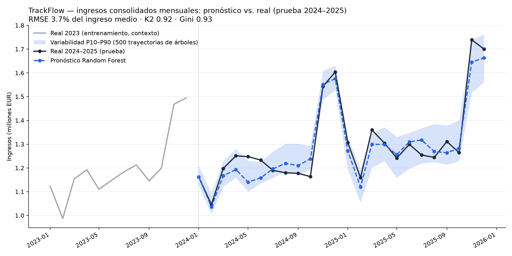

# Pronóstico de ingresos mensuales — TrackFlow

Modelo para estimar `revenue_eur` consolidado de los próximos meses, como prueba de viabilidad antes del dashboard ejecutivo global.

- Script: [`train_sales_forecast.py`](train_sales_forecast.py)
- Datos: `mock_data/raw/trackflow_sales.csv` (el `data/raw/` del briefing equivale a `mock_data/raw/` en este repositorio)
- Pruebas: [`tests/pipelines/test_sales_forecast.py`](../tests/pipelines/test_sales_forecast.py)
- Salidas: `reports/sales_forecast/` (`metrics.json`, `predictions_2024_2025.csv` y `sales_forecast_test_2024_2025.png`)

```bash
uv sync
uv run python scripts/train_sales_forecast.py
uv run pytest tests/pipelines/test_sales_forecast.py -q
```

## Datos y preparación

| Columna | Uso |
|---|---|
| `month` | Eje temporal (`YYYY-MM-01`) y features de calendario |
| `revenue_eur` | **Variable objetivo** (filas `market == "consolidated"`) |
| `shipments_processed` | Se valida e imputa. No es feature porque es contemporánea al target (`revenue ≈ envíos × precio`) y su valor futuro no se conoce al pronosticar |
| `avg_revenue_per_shipment_eur` | Se valida e imputa. Se usa como indicador de PSI del mix de mercado |
| `market` | Filtro: solo `consolidated` |

**Valores nulos o vacíos.** Las celdas vacías o `null` y los valores no numéricos se convierten en NaN. Los valores `≤ 0` también se tratan como NaN, porque el briefing exige ingresos positivos. Las filas con mes inválido se descartan, y los meses que faltan entre 2016-01 y 2025-12 se reinsertan como filas vacías. La imputación se hace con interpolación temporal **después del split y por separado en cada partición**, de modo que un hueco de 2023 nunca se rellena con datos de 2024. El número de valores imputados queda registrado en `metrics.json`. El CSV actual no tiene nulos, así que se imputaron 0 valores.

**Split.** Se separa por año calendario: 2016–2023 para entrenamiento (96 meses) y 2024–2025 para prueba (24 meses). El pronóstico de prueba es recursivo a 24 meses: cada paso usa sus propias predicciones anteriores y nunca un valor real de prueba. Las pruebas unitarias lo comprueban multiplicando ×50 los ingresos de 2024–2025 y verificando que el pronóstico no cambia.

**Escalado.** Los ingresos crecen entre un 3 % y un 9 % al año, así que los EUR de 2025 no son comparables con los de 2016. Por eso todas las features y el target son **ratios logarítmicos de la serie consigo misma**:

- Target: `log(revenue_t / revenue_{t-12})`, es decir, el crecimiento interanual. Después se reconstruye `revenue_t = revenue_{t-12} · e^pred`.
- Features: crecimiento interanual del último mes, crecimiento de los últimos 12 meses frente a los 12 anteriores, peso estacional del mismo mes del año anterior, momentum de 3 frente a 12 meses, mes codificado en seno y coseno, y los indicadores `nov–dic` (Black Friday y Navidad) y `febrero`.
- Además, un `StandardScaler` ajustado solo con train pone cada feature en media 0 y desviación 1. Random Forest es invariante a este escalado, pero el pipeline sigue siendo correcto si se cambia a un estimador sensible a magnitudes.

Este escalado relativo es lo que permite que un modelo de árboles funcione aquí. Los árboles no extrapolan, y 2024–2025 está por encima de todo el histórico. Una primera versión que predecía EUR directamente tenía un error RMSE del 10,7 %, y esta tiene un 3,7 %.

## Por qué Random Forest y no XGBoost

| Criterio | Decisión |
|---|---|
| Tamaño de datos | Hay 72 filas de entrenamiento útiles. El boosting sobreajusta con facilidad con tan pocos datos y necesita early stopping con un conjunto de validación que no existe sin tocar 2024–2025 |
| Explicabilidad | Da importancias de variables, y las predicciones por árbol dan el área de variabilidad sin supuestos adicionales |
| Tiempo de ajuste | Funciona con hiperparámetros razonables sin búsqueda (500 árboles, `min_samples_leaf=3`, `max_features=0.6`) y tarda unos segundos |

## Resultados en prueba (2024–2025)

| Métrica | Valor |
|---|---|
| MSE | 2,28 × 10⁹ EUR² |
| RMSE como % del ingreso mensual medio (1,30 M EUR) | **3,7 %** (unos 47,7 k EUR) |
| MAPE | 2,9 % |
| K2 Score (R²) | **0,92** |
| Gini normalizado | **0,93** |
| PSI del crecimiento interanual (train frente a test) | 0,09, estable |
| PSI de `avg_revenue_per_shipment_eur` | 0,35, cambio significativo |
| Línea base "repetir 2023" (RMSE %) | 9,5 % |

La revisión de patrones confirma lo descrito en el briefing. Noviembre está un +25,3 % y diciembre un +24,0 % sobre la media anual, y febrero un −15,9 %. El resto de los meses están entre −5 % y −2 %. El crecimiento anual alterna entre valores bajos (1,8–4 %) y altos (7,9–10,1 %). En algunos años la variación aleatoria saca estas cifras ligeramente del rango nominal de 3–9 %.



El área sombreada es el P10–P90 de 500 trayectorias recursivas, una por árbol. Se ensancha en 2025 porque el error se acumula con el horizonte. Es una banda **descriptiva** de la variabilidad del modelo, no un intervalo de confianza calibrado.

## Qué mide cada métrica

- **MSE (Mean Squared Error).** Es la media del error al cuadrado, en EUR². Penaliza mucho los errores grandes, como fallar el pico de noviembre y diciembre. Como EUR² no se interpreta de forma directa, se reporta también la raíz del MSE como porcentaje del ingreso mensual medio. Ese porcentaje es la cifra útil para Thomas y Ana: "nos equivocamos de media un 3,7 % de un mes típico".
- **K2 Score (R², coeficiente de determinación).** Es la proporción de la variación mensual real que explica el modelo. Vale 1 si es perfecto y 0 si no mejora a predecir la media del periodo. El enunciado lo llama "K2"; aquí se interpreta como el R² de `sklearn.metrics.r2_score`.
- **Gini normalizado.** Mide la capacidad de **ordenar** los meses de mayor a menor ingreso. Vale 1 si el orden es perfecto y 0 si es aleatorio. Es lo que necesita Thomas para distinguir un febrero bajo pero normal de una caída atípica: si el modelo ordena bien, un mes real muy por debajo del puesto que le asignó el modelo es una anomalía que hay que investigar.
- **PSI (Population Stability Index).** Mide cuánto cambió una distribución entre entrenamiento y prueba. Por debajo de 0,10 es estable, entre 0,10 y 0,25 es un cambio moderado y por encima de 0,25 es un cambio significativo. Los bins se ajustan a unas 5 observaciones por bin, porque con 24 meses de prueba y 10 bins el PSI se dispara por ruido. Se reporta sobre:
  - el **crecimiento interanual** (lo que predice el modelo), que es estable;
  - el **ingreso medio por envío**. El CSV solo trae la fila `consolidated`, así que el mix entre Los Ángeles y Zaragoza no es observable directamente. Si EE. UU. (≈60 %) y España (≈40 %) tienen precios por envío distintos, un cambio en este indicador apunta a un cambio de mix. Sale 0,35, porque 2024 tiene el ingreso por envío medio más alto de la serie (15,25 EUR). Se reporta como señal a revisar con Operaciones, no como prueba de expansión o contracción de un país;
  - el revenue bruto (≈5,2) se incluye en `metrics.json` solo como referencia. Es alto por construcción, porque la serie crece, y no indica deriva.

### Por qué un MSE bajo no basta

1. **Depende de la escala.** Un MSE "bajo" en EUR² no dice nada sin compararlo con el ingreso medio o con una línea base. Por eso se reporta en porcentaje y frente a "repetir 2023" (9,5 %).
2. **Es un promedio.** Un modelo puede tener buen MSE prediciendo bien 20 meses tranquilos y fallando justo el pico de Black Friday, que es el mes que más importa para la planificación de almacén y carriers. El Gini muestra si se capturan los altibajos.
3. **No detecta deriva.** El MSE mide el pasado de prueba. El PSI avisa si los datos nuevos ya no se parecen a los de entrenamiento, y en ese caso el MSE histórico deja de ser fiable.
4. **No dice cuánto explica el modelo.** El R² (K2) indica qué parte de la variabilidad real se capta, frente a predecir simplemente la media.

## Limitaciones

- Solo se usa la serie consolidada, sin separar por mercado. El PSI del mix es una aproximación.
- La banda de variabilidad no está calibrada. Con solo 24 meses de prueba no se puede validar su cobertura de forma fiable.
- El crecimiento alterno (alto, bajo) es difícil de aprender con 6 ciclos anuales, y es la principal fuente de error residual.
